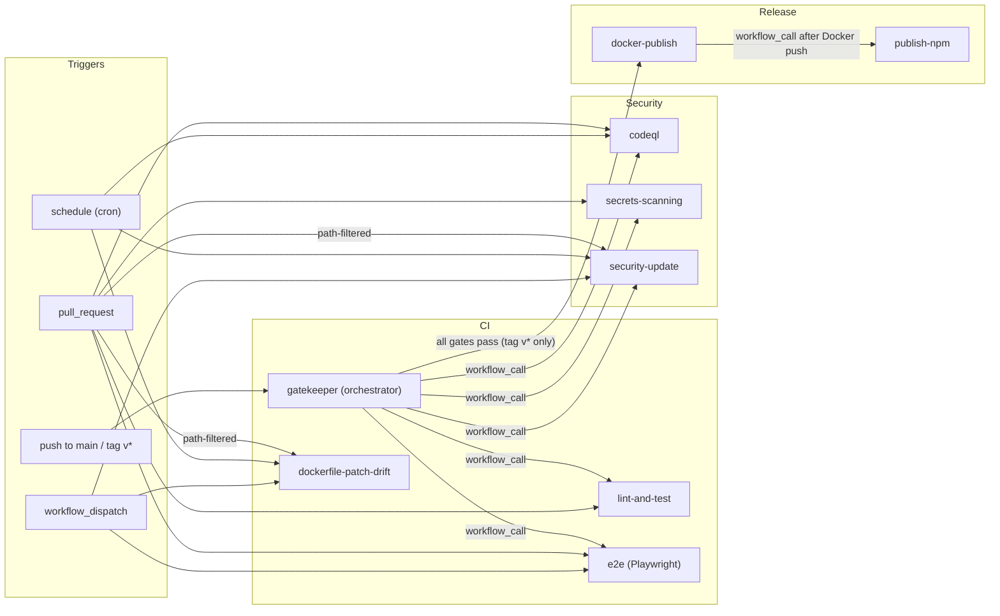

# CI/CD Workflows

This directory contains all GitHub Actions workflows for the **memory-journal-mcp** project. The pipeline is organized into three layers: continuous integration, security scanning, and automated release/publishing.

## Workflow Map



---

## Workflows

### CI / Orchestration

| File                                                                     | Trigger                                  | Purpose                                                                                                                                                                                             |
| ------------------------------------------------------------------------ | ---------------------------------------- | --------------------------------------------------------------------------------------------------------------------------------------------------------------------------------------------------- |
| [gatekeeper.yml](gatekeeper.yml)                                         | push to `main` / tag `v*`                | Orchestrates CI/CD: fans out 5 verification gates (`lint-and-test`, `codeql`, `secrets-scanning`, `security-update`, `e2e`) on `push to main` and `tag v*`; triggers `docker-publish.yml` **only** on `tag v*` pushes (`refs/tags/v*`) |
| [lint-and-test.yml](lint-and-test.yml)                                   | PR to `main` / `workflow_call`           | Lint, typecheck, build, unit & E2E tests (Node 24.x + 26.x matrix), pnpm audit, Docker smoke test                                                                                                   |
| [e2e.yml](e2e.yml)                                                       | PR to `main` / manual / `workflow_call`  | Playwright E2E Tests                                                                                                                                                                                |
| [dockerfile-patch-drift.yml](dockerfile-patch-drift.yml)                 | PR (path-filtered) / daily (12:00 UTC) / manual | Dockerfile Patch Drift Check (`Dockerfile` vs `package.json overrides`)                                                                                                                             |

### Security

| File                                         | Trigger                                                | Purpose                                                                                            |
| -------------------------------------------- | ------------------------------------------------------ | -------------------------------------------------------------------------------------------------- |
| [codeql.yml](codeql.yml)                     | PR / weekly (Mon 02:23 UTC) / `workflow_call`          | CodeQL static analysis for `javascript-typescript` and `actions`                                   |
| [secrets-scanning.yml](secrets-scanning.yml) | PR / `workflow_call`                                   | TruffleHog (verified secrets) scanning                                                             |
| [security-update.yml](security-update.yml)   | PR (path-filtered) / weekly (Sun 02:00 UTC) / manual / `workflow_call` | Docker image Trivy scan (CRITICAL/HIGH/MEDIUM), SARIF upload, auto-creates GitHub issue on failure |

### Release & Publishing

| File                                     | Trigger                                                                             | Purpose                                                                                                                                                |
| ---------------------------------------- | ----------------------------------------------------------------------------------- | ------------------------------------------------------------------------------------------------------------------------------------------------------ |
| [docker-publish.yml](docker-publish.yml) | `workflow_call` from gatekeeper (on `tag v*` pushes after all 5 gates pass)         | Docker Scout scan + smoke test → multi-arch Docker build (amd64 + arm64) + SBOM/provenance attestation → manifest merge + Docker Hub README update → npm publish handoff |
| [publish-npm.yml](publish-npm.yml)       | `workflow_call` (from docker-publish)                                               | Publishes to npm with version verification                                                                                                             |

---

## Release Pipeline

The full verification and release flow for `main` and version tags (`v*`):

```
push to main / tag v*
  → gatekeeper (orchestrator)
      ├── lint-and-test    ──┐
      ├── codeql             │
      ├── secrets-scanning   ├── all 5 gates must pass
      ├── security-update    │
      └── e2e              ──┘
            ↓ all gates pass AND ref is refs/tags/v*
          docker-publish (Docker Scout + smoke test → multi-arch build + SBOM/provenance → manifest merge + Docker Hub README)
            ↓ workflow_call
          publish-npm (npm publish with provenance)
```

For manual feature releases, the maintainer runs `/bump-deploy` locally which pushes a `v*` tag, triggering the gatekeeper pipeline and subsequent release jobs.

---

## Secrets Required

| Secret            | Used By                                                  | Purpose                        |
| ----------------- | -------------------------------------------------------- | ------------------------------ |
| `GITHUB_TOKEN`    | docker-publish, security-update, codeql                  | Git operations, SARIF upload, issue creation |
| `NPM_TOKEN`       | publish-npm                     | npm registry authentication    |
| `DOCKER_USERNAME` | docker-publish                  | Docker Hub login               |
| `DOCKER_PASSWORD` | docker-publish                  | Docker Hub login               |

---

## Editing Guidelines

- **YAML workflows** — edit directly, commit to `main` or via PR
