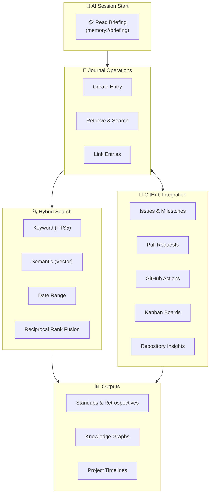
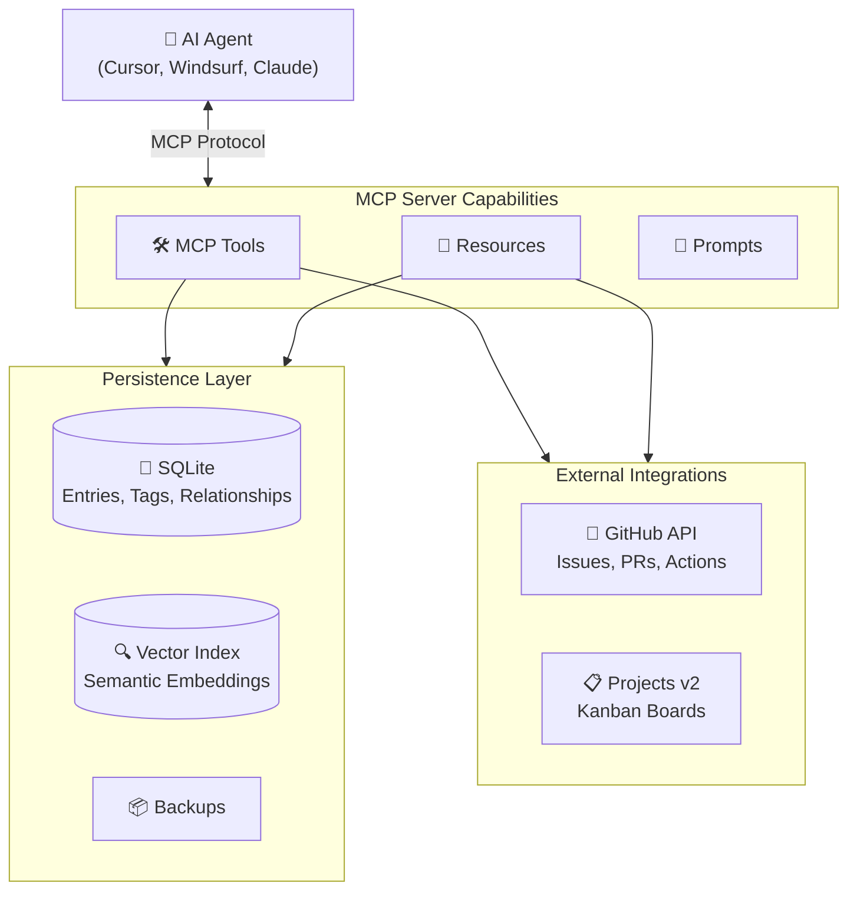

# Memory Journal MCP Server

<!-- mcp-name: io.github.neverinfamous/memory-journal-mcp -->

[](https://github.com/neverinfamous/memory-journal-mcp) [](https://www.npmjs.com/package/memory-journal-mcp) [](https://hub.docker.com/r/writenotenow/memory-journal-mcp)
[](https://opensource.org/licenses/MIT) 
[](https://registry.modelcontextprotocol.io/v0/servers?search=io.github.neverinfamous/memory-journal-mcp) [](SECURITY.md) [](https://github.com/neverinfamous/memory-journal-mcp) [](https://github.com/neverinfamous/memory-journal-mcp)
   [](https://github.com/neverinfamous/memory-journal-mcp/wiki/Performance) [](https://github.com/neverinfamous/memory-journal-mcp/actions/workflows/gatekeeper.yml)

**[📚 Full Documentation (Wiki)](https://github.com/neverinfamous/memory-journal-mcp/wiki)** • **[Changelog](CHANGELOG.md)** • **[Security](SECURITY.md)** • **[Release Article](https://adamic.tech/articles/memory-journal-mcp-server)**

> [!TIP]
> **Value Proposition**
> Bridge disconnected AI sessions seamlessly. Enable persistent project memory instantly. Automate handoffs with robust GitHub integration. Eliminate AI amnesia today.

**🚀 Quick Deploy:**

- **[npm Package](https://www.npmjs.com/package/memory-journal-mcp)** - `npm install -g memory-journal-mcp` (or `pnpm add -g memory-journal-mcp`)
- **[Docker Hub](https://hub.docker.com/r/writenotenow/memory-journal-mcp)** - Alpine-based with full semantic search

## 🧠 Eliminate AI Amnesia

Large projects face a critical challenge. You lose context between sessions.

- **Stop Thread Amnesia** - AI conversations start fresh. They ignore previous work.
- **Retain Deep Context** - Decisions and code scatter across threads; Memory Journal preserves them automatically.
- **End Repeated Work** - AI repeats failed solutions; persistent history tracks every prior attempt.
- **Prevent Context Overload** - Manual history copying wastes tokens; dynamic briefings deliver targeted context automatically.

Memory Journal builds your project's long-term memory. It acts as a **Project Context Graph** for AI-assisted engineering. It bridges **human workflows** (Issues, PRs, Kanban, Milestones) with **agent execution** (Git, tests, decisions).

---

**Experience true context-aware development:**

- _"Why did we choose SQLite over Postgres for this service last month?"_ (Semantic search)
- _"Run the `/issue-commander` (`triage` workflow) on the top priority ticket in the Kanban board."_ (GitHub operations)
- _"Who has been touching the auth module recently, and what's our team collaboration density?"_ (Team analytics)
- _"Commit the changes and automatically generate a structured journal entry using the \`--journal\` wrapper flag."_ (Automated lifecycles)
- _"Draw a visual graph showing how my last 10 architectural decisions relate to each other."_ (Knowledge graph)

**Comprehensive access to internal state via resources (`memory://briefing`, `memory://workflows`, `memory://rules`, `memory://health`, `memory://help`, `memory://staleness`, GitHub status/milestones, team stats, and metrics/latency). Dynamic repo variants also support cross-repo targeting (like `memory://briefing/{+repo}` or `memory://kanban/{+repo}/{project_number}`).** **[Resources documentation →](https://github.com/neverinfamous/memory-journal-mcp/wiki/Resources)**

---

## 🎯 What Sets Us Apart

**MCP Tools** · **Workflow Prompts** · **Resources** · **Tool Groups** · **Code Mode** · **GitHub Commander** (Issue Triage, PR Review, Milestone Sprints, Security/Quality/Perf Audits) · **GitHub Integration** (Issues, PRs, Actions, Kanban, Milestones, Insights) · **Team Collaboration** (Shared DB, Vector Search, Cross-Project Insights)

| Feature                       | Description                                                                                                          |
| ----------------------------- | -------------------------------------------------------------------------------------------------------------------- |
| **Session Intelligence**      | Auto-query project history, create checkpoints, and hand off context between sessions automatically.                 |
| **GitHub Integration**        | Manage Issues, PRs, Actions, Kanban boards, and milestones. Access Copilot reviews and repository insights.          |
| **Dynamic Project Routing**   | Switch contexts seamlessly and access CI/Issue tracking across multiple repositories from a single server instance.  |
| **Knowledge Graphs**          | Link specifications, implementations, tests, and PRs visually using Mermaid diagrams.                                |
| **Hybrid Search**             | Find entries instantly using a blend of keyword, semantic, and date-range searches.                                  |
| **Code Mode**                 | Execute multi-step operations efficiently in a sandboxed environment to reduce token usage.                          |
| **Adaptive Session Briefing** | Deliver real-time workspace context dynamically, including live CI health, local Git status, and unreleased changes. |
| **Reports & Analytics**       | Generate standups, retrospectives, PR summaries, digests, and period analyses.                                       |
| **Heuristic Scoring**         | Optimize context delivery by scoring entries based on veracity and impact.                                           |
| **Team Collaboration**        | Share databases across teams with cross-project insights, author attribution, and role-based access control.         |
| **Data Interoperability**     | Export schemas safely, sync Markdown directories, and maintain a unified IO namespace.                               |
| **Backup & Restore**          | Secure data with automated scheduling, retention policies, and one-command restores.                                 |
| **Auto-Pruning**              | Soft-delete low-value entries automatically to maintain search relevance over long-running projects.                 |
| **Security & Transport**      | Ensure secure connections with OAuth 2.1, Streamable HTTP, rate limiting, and SQL injection prevention.              |
| **Structured Error Handling** | Provide agents with classification, remediation hints, and recoverability signals on every tool call.                |
| **Agent Collaboration**       | Share context between IDE agents and Copilot. Search review findings and let agents suggest reusable rules.          |
| **Native Agent Skills**       | Establish permanent AI behavior and architecture rules using bundled foundational coding paradigms.                  |
| **GitHub Commander**          | Audit code, triage issues, review PRs, and run sprint milestones via automated pipeline skills.                      |

---

### Isolate Environments with Multi-Tenancy

Memory Journal supports multi-tenancy out of the box via the `workspace_id` construct, acting as a strict isolation barrier for multiple journals sharing the same SQLite database file.

- **Auto-Resolution:** When `workspace_id` is omitted, the server automatically resolves the target workspace. It matches `project_number` against `PROJECT_REGISTRY`, checks content/tag keyword aliases, or inspects `process.cwd()` before falling back to `DEFAULT_WORKSPACE_ID` (default: `default`).
- **Data Partitioning & Cross-Workspace Queries:** Core CRUD, Soft-Delete/Restore, FTS5 Search, Vector Semantic Search (`semantic_search`), and Analytics tools enforce `workspace_id` isolation end-to-end. Read and search tools accept `workspace_id: "*"` to query across all workspaces. External write and mutation paths reject wildcard overrides.
- **Immutability & Controlled Migration:** Entries receive a `workspace_id` upon creation that standard updates cannot overwrite directly. To migrate an entry across workspaces, call `update_entry` with `workspace_id: "*"` and `target_workspace_id`.
- **Server Config:** Set `--default-workspace-id` (or the `DEFAULT_WORKSPACE_ID` environment variable) to configure the default fallback workspace for the server instance. This lets you run multiple isolated journal interfaces on a single physical database.

---



---

_Suggested Rule (Add to AGENTS.md, GEMINI.md, system prompts, etc.)_

<details>
<summary><strong>View Session Initialization Routine</strong></summary>

🛑 Session Initialization Routine

When the user initializes the session context by executing the `load-briefing` prompt:

1. You will receive the output of the `memory://briefing/{repo_name}` resource.
2. Prepend your response EXACTLY as:
   > **📋 Briefing loaded** — `{repo_name}`
   > _{paste ENTIRE briefing here}_
3. Address the user's request below the briefing.
4. NEVER autonomously execute tasks listed in the briefing.
5. Do NOT proactively ask the user to load the briefing. Wait for them to use the prompt.
</details>

---

### Control Access with Tool Filtering

> [!IMPORTANT]
> All shortcuts and tool groups always include **Code Mode** (`mj_execute_code`) and **Runtime Configuration** (`update_configuration`) as escape-hatch tools so agents can never lock themselves out of the configuration system or Code Mode.

Control which tools are exposed using any of the 3 configuration sources (precedence: CLI flag > environment variable > config file):

- **CLI flag**: `--tool-filter <filter>`
- **Environment variable**: `MEMORY_JOURNAL_MCP_TOOL_FILTER` _(Note: `TOOL_FILTER` is only a fallback display variable in the session briefing and does **not** activate tool filtering on its own)_
- **`memory-journal.config.{yaml,yml,json}` key**: `"toolFilter"`

| Filter               | Use Case                           |
| -------------------- | ---------------------------------- |
| `full`               | All tools (default)                |
| `starter`            | Core + search + codemode           |
| `essential`          | Minimal footprint                  |
| `readonly`           | Disable all mutations              |
| `codemode`           | `mj_execute_code` + runtime config |
| `-github`            | Exclude a group                    |
| `-github,-analytics` | Exclude multiple groups            |

**Filter Syntax:** `shortcut` or `group` or `tool_name` (whitelist mode) · `-group` (disable group) · `-tool` (disable tool) · `+tool` (re-enable after group disable)

**Custom Selection:** List individual tool names to create your own whitelist: `--tool-filter "create_entry,search_entries,semantic_search"`

**Groups:** `core`, `search`, `analytics`, `relationships`, `io`, `admin`, `github`, `git`, `backup`, `team`, `codemode`

**[Complete tool filtering guide →](https://github.com/neverinfamous/memory-journal-mcp/wiki/Tool-Filtering)**

---

## 📋 Unlock Core Capabilities

### 🛠️ **MCP Tools**

| Group           | Description                                                                                                                                                                                         |
| --------------- | --------------------------------------------------------------------------------------------------------------------------------------------------------------------------------------------------- |
| `codemode`      | Code Mode (sandboxed code execution) 🌟 **Recommended**                                                                                                                                             |
| `core`          | Entry creation/read/history, tags, resource & briefing helpers, anchor staleness, test                                                                                                              |
| `search`        | Text search, date range, semantic, vector stats, deleted entries, cross-team                                                                                                                        |
| `analytics`     | Statistics, cross-project insights                                                                                                                                                                  |
| `relationships` | Link entries, visualize graphs                                                                                                                                                                      |
| `io`            | JSON/Markdown export, Markdown directory import/export, and external knowledge base import (Notion, Obsidian, Logseq)                                                                               |
| `admin`         | Update configuration, project registry management, entry update/delete/restore, rebuild/add to vector index, merge tags, search audit log, auto-prune, bulk operations (batch create/update/delete) |
| `github`        | Issues, PRs, context, Kanban, **Milestones**, **Insights**, **issue lifecycle**, **Copilot Reviews**                                                                                                |
| `git`           | Commit history, search, release info, patterns, staleness checks                                                                                                                                    |
| `backup`        | Backup, list, restore, cleanup                                                                                                                                                                      |
| `team`          | CRUD, search, stats, relationships, IO (Markdown & external import/export), backup, vector search, cross-project insights, matrix, RBAC member management, author aliases (requires `TEAM_DB_PATH`) |

**[Complete tools reference →](https://github.com/neverinfamous/memory-journal-mcp/wiki/Tools)**

### 🎯 **Workflow Prompts**

Specialized workflow prompts cover session briefing, standup & retro prep, goal tracking, PR & issue command, session summaries, and journal optimization. Additional prompts support CMS REM supervision, adversarial plan reviews, code & security audits, secure commit workflows, and anti-hallucination healing. **[Complete prompts guide →](https://github.com/neverinfamous/memory-journal-mcp/wiki/Prompts)**

### 📡 **Resources**

See the **[Complete resources guide →](https://github.com/neverinfamous/memory-journal-mcp/wiki/Resources)** for the full list of dynamic context resources, including `memory://briefing`, `memory://instructions`, GitHub integration endpoints, telemetry metrics, and templated views.

- **Dynamic Resource Templates**: Resources `memory://briefing/{+repo}`, `memory://agent-context/{+repo}`, `memory://agent-id/{+repo}`, `memory://actions/recent/{+repo}`, `memory://github/status/{+repo}`, `memory://github/milestones/{+repo}`, `memory://milestones/{+repo}/{number}`, and `memory://kanban/{+repo}/{project_number}` accept an RFC 6570 `{+repo}` path parameter for targeted project context.

---

## ⚡ Code Mode: Maximum Efficiency (90% Token Savings)

Code Mode (`mj_execute_code`) **reduces token usage by up to 90%** and is included by default in all presets. Instead of spending thousands of tokens on sequential tool calls, AI agents use a single sandboxed execution to reason faster.

Code executes in a **pre-warmed `worker_threads` V8 isolate pool + secondary `vm.createContext` boundary** designed as a secure multi-tenant process isolation environment. All `mj.*` API calls execute against the journal within the sandbox, providing:

- **V8 code generation restrictions** — `eval()` and `Function()` construction from strings disabled at the V8 engine level via `codeGeneration: { strings: false, wasm: false }`
- **Frozen prototypes & cross-realm constructor lockdown** — all built-in prototypes (`Object`, `Function`, `Array`, `Error`, etc.) and `mj.*` API bindings are frozen, and `.constructor` is neutered across `Object`, `Function`, `AsyncFunction`, `GeneratorFunction`, and `AsyncGeneratorFunction` prototypes in both the inner `vm` realm and outer worker realm to prevent dynamic constructor chain escapes
- **Single-pass lexical validation** — pre-validation rate-limiting and 50KB byte caps run before any code normalization, followed by a single-pass lexical comment/string scanner (preserving `${...}` template expressions) and static rules blocking `require()`, `import()`, `process`, `eval()`, `Reflect.*`, `Symbol.*`, `Object.getPrototypeOf`/`setPrototypeOf`/`defineProperty`, `new Proxy()`, and filesystem/network access
- **Proxy constructor nullified** — `Proxy: undefined` in the sandbox prevents meta-object protocol abuse
- **Prototype-safe RPC allowlist** — host-side `Object.hasOwn()` validation, recursion-bounded argument normalization, and `--tool-filter` enforcement prevent workers from invoking unauthorized or filtered API methods
- **Rate limiting** — 60 executions per minute per client
- **Hard timeouts** — configurable execution limit (default 30s) with bounded async timer tracking (`setTimeout`/`sleep` capped and cleared on completion)
- **Egress boundary enforcement** — result serialization capped (default 100KB via `CODE_MODE_MAX_RESULT_SIZE`) with automatic payload compaction to prevent OOM via oversized payloads
- **Full API access** — all tool groups are available via `mj.*` (e.g., `mj.core.createEntry()`, `mj.search.searchEntries()`, `mj.github.getGithubIssues()`)
- **Strict Readonly Contract** — Calling any mutation method under `--tool-filter readonly` safely halts the sandbox to prevent execution, returning a structured `{ success: false, error: "..." }` response to the agent instead of a raw MCP protocol exception.

### ⚡ Code Mode Minimal Surface (Maximum Token Savings)

Run with the `codemode` filter and `--codemode-internal-full-access` to expose only the escape-hatch tools (`mj_execute_code` and `update_configuration`) on the MCP tool list while retaining full internal access to the `mj.*` API inside the sandbox:

```json
{
  "mcpServers": {
    "memory-journal-mcp": {
      "command": "memory-journal-mcp",
      "args": ["--tool-filter", "codemode", "--codemode-internal-full-access"]
    }
  }
}
```

This exposes only `mj_execute_code` and `update_configuration` to the client's `tools/list`, reducing tool schema overhead to the minimum while preserving full programmatic capability via `mj.*`. The agent writes JavaScript against the typed `mj.*` SDK — composing operations across all tool groups and returning exactly the data it needs — in one execution. This mirrors the [Code Mode pattern](https://blog.cloudflare.com/code-mode-mcp/) pioneered by Cloudflare for their entire API: fixed token cost regardless of how many capabilities exist. Without `--codemode-internal-full-access` (or `CODEMODE_INTERNAL_FULL_ACCESS=true`), internal `mj.*` methods are scoped to the active `--tool-filter`.

---

## 🚀 Quick Start & Deployment

_Note: Configuration is resolved using strict precedence: `CLI flags > Environment Variables > Config File > Defaults`._

> 🛠️ **Debugging Configuration:** Run `memory-journal-mcp --dump-config` (or pass `--dump-config` as an arg) to print the fully resolved configuration payload with automatically redacted secrets. This is the primary method for diagnosing overriding issues.

### Configure Basics Quickly

> 💡 **Tip:** Don't want to manually escape JSON strings for `PROJECT_REGISTRY`? Run `npx memory-journal-mcp project create <name> --path <repo-path> [--number <project-number>]` in your terminal to automatically bootstrap and update your MCP configuration!

```json
{
  "mcpServers": {
    "memory-journal-mcp": {
      "command": "memory-journal-mcp",
      "env": {
        "GITHUB_TOKEN": "ghp_your_token_here",
        "PROJECT_REGISTRY": "{\"my-repo\":{\"path\":\"/path/to/your/git/repo\",\"project_number\":1}}",
        "ALLOWED_IO_ROOTS": "/path/to/your/git/repo"
      }
    }
  }
}
```

### Power Up with Advanced Configuration

Showcasing the full power of the server, including Multi-Project Routing, Team Collaboration, Copilot awareness, and Context Injections.

> 💡 **Tip:** Use `npx memory-journal-mcp project create <name> --path <repo-path> [--number <project-number>]` to easily configure multiple repositories into your `PROJECT_REGISTRY` without manual JSON escaping!

```json
{
  "mcpServers": {
    "memory-journal-mcp": {
      "command": "memory-journal-mcp",
      "args": ["--tool-filter", "codemode"],
      "env": {
        "DB_PATH": "/path/to/your/memory_journal.db",
        "TEAM_DB_PATH": "/path/to/shared/team.db",
        "GITHUB_TOKEN": "ghp_your_token_here",
        "PROJECT_REGISTRY": "{\"my-repo\":{\"path\":\"/path/to/repo\",\"project_number\":1},\"other-repo\":{\"path\":\"/path/to/other\",\"project_number\":5}}",
        "ALLOWED_IO_ROOTS": "/path/to/repo,/path/to/other,/path/to/your/skills",
        "AUTO_REBUILD_INDEX": "true",
        "CODEMODE_INTERNAL_FULL_ACCESS": "true",
        "BRIEFING_ENTRY_COUNT": "3",
        "BRIEFING_SUMMARY_COUNT": "1",
        "BRIEFING_INCLUDE_TEAM": "true",
        "BRIEFING_ISSUE_COUNT": "3",
        "BRIEFING_PR_COUNT": "3",
        "BRIEFING_PR_STATUS": "true",
        "BRIEFING_WORKFLOW_COUNT": "3",
        "BRIEFING_WORKFLOW_STATUS": "true",
        "BRIEFING_COPILOT_REVIEWS": "true",
        "RULES_FILE_PATH": "/path/to/your/RULES.md",
        "SKILLS_DIR_PATH": "/path/to/your/skills",
        "MEMORY_JOURNAL_WORKFLOW_SUMMARY": "/deploy: prod deployment | /audit: security scan",
        "AUDIT_LOG_PATH": "/path/to/your/mcp-audit.jsonl",
        "TEAM_AUTHOR": "your_username"
      }
    }
  }
}
```

> 💡 **Tip:** Optimize your context window! **Journal entries** (`BRIEFING_ENTRY_COUNT`) capture frequent, granular actions (e.g. bug fixes, implementation steps). **Session summaries** (`BRIEFING_SUMMARY_COUNT`) surface high-level retrospectives meant to pass strategic context continuously across distinct AI sessions. Use both appropriately to keep the agent briefing highly focused!

### 📋 Customizing the Session Briefing

The `memory://briefing` resource is **dynamically assembled** at each session start to provide rich, token-efficient ambient context. By default, it automatically surfaces:

- **System State:** Server version, capability statuses, resource/tool counts, test health, and `memory://metrics/summary` breadcrumbs.
- **Repository Context:** Git working tree status, unreleased changes, exact code-map paths, and prioritized gatekeeper CI workflows.
- **Ambient Context:** Active workspace paths, local time, analytics.

You control exactly what additional content your agent sees across three dimensions:

| Dimension             | Variables                                                                                                                                                                        | What It Controls                                                                        |
| --------------------- | -------------------------------------------------------------------------------------------------------------------------------------------------------------------------------- | --------------------------------------------------------------------------------------- |
| **Focus**             | `MEMORY_JOURNAL_MCP_TOOL_FILTER` (CLI: `--tool-filter`, config: `"toolFilter"`)                                                                                                  | Control tool exposure: `full` (default), `starter`, `essential`, `readonly`, `codemode` |
| **Journal Content**   | `BRIEFING_ENTRY_COUNT`, `BRIEFING_SUMMARY_COUNT`, `BRIEFING_COMMIT_COUNT`, `BRIEFING_IMPORTANCE_THRESHOLD`, `BRIEFING_INCLUDE_TEAM`                                              | How many recent entries, session summaries, commits, and whether team entries appear    |
| **GitHub Enrichment** | `BRIEFING_ISSUE_COUNT`, `BRIEFING_PR_COUNT`, `BRIEFING_PR_STATUS`, `BRIEFING_MILESTONE_COUNT`, `BRIEFING_WORKFLOW_COUNT`, `BRIEFING_WORKFLOW_STATUS`, `BRIEFING_COPILOT_REVIEWS` | Issues, PRs, milestones, CI runs, and Copilot review state surfaced in the briefing     |

**Context Injections:** Set `RULES_FILE_PATH` and `SKILLS_DIR_PATH` to surface user rules and agent skills as companion resources (`memory://rules`, `memory://skills`) alongside the briefing.

**Repo Targeting:** In multi-repo setups, agents read `memory://briefing/{+repo}` to get a briefing scoped to a specific repository registered in `PROJECT_REGISTRY`.

<details>
<summary><strong>Briefing Presets (click to expand)</strong></summary>

**Minimal (fast sessions)** — Reduce briefing to bare essentials for quick interactions:

```json
"BRIEFING_ENTRY_COUNT": "1",
"BRIEFING_SUMMARY_COUNT": "0",
"MEMORY_JOURNAL_MCP_TOOL_FILTER": "essential"
```

**Full Context (onboarding agents)** — Maximize context for agents unfamiliar with the project:

```json
"BRIEFING_ENTRY_COUNT": "5",
"BRIEFING_SUMMARY_COUNT": "3",
"BRIEFING_INCLUDE_TEAM": "true",
"BRIEFING_ISSUE_COUNT": "5",
"BRIEFING_PR_COUNT": "3",
"BRIEFING_PR_STATUS": "true",
"BRIEFING_COPILOT_REVIEWS": "true",
"MEMORY_JOURNAL_MCP_TOOL_FILTER": "full"
```

**DevOps-Heavy** — Emphasize CI/CD and GitHub state for infrastructure workflows:

```json
"BRIEFING_WORKFLOW_COUNT": "5",
"BRIEFING_WORKFLOW_STATUS": "true",
"BRIEFING_ISSUE_COUNT": "3",
"BRIEFING_PR_COUNT": "3",
"BRIEFING_PR_STATUS": "true",
"BRIEFING_COPILOT_REVIEWS": "true"
```

</details>

**[Full briefing customization guide →](https://github.com/neverinfamous/memory-journal-mcp/wiki/Configuration#session-briefing-customization)**

**Variants** (modify the config above):

| Variant                 | Change                                                                                                                                                                                                                                                              |
| ----------------------- | ------------------------------------------------------------------------------------------------------------------------------------------------------------------------------------------------------------------------------------------------------------------- |
| **Minimal (no GitHub)** | Remove the `env` block entirely                                                                                                                                                                                                                                     |
| **npx (no install)**    | Replace `"command"` with `"npx"` and add `"args": ["-y", "memory-journal-mcp"]`                                                                                                                                                                                     |
| **From source**         | Replace `"command"` with `"node"` and add `"args": ["dist/cli.js"]`                                                                                                                                                                                                 |
| **Code Mode minimal**   | Add `"args": ["--tool-filter", "codemode", "--codemode-internal-full-access"]` (`mj_execute_code` + `update_configuration`, all `mj.*` capabilities)                                                                                                                |
| **Docker**              | Replace `"command"` with `"docker"` and add `"args": ["run", "-i", "--rm", "-v", "./data:/app/data", "-e", "GITHUB_TOKEN", "-e", "PROJECT_REGISTRY", "-e", "ALLOWED_IO_ROOTS", "writenotenow/memory-journal-mcp:latest"]` (forward any `"env"` keys via `-e <VAR>`) |
| **Team collaboration**  | Add `"TEAM_DB_PATH": "./team.db"` to `env`                                                                                                                                                                                                                          |

Restart your MCP client and start journaling!

### Connect Remotely with HTTP/SSE Transport

> [!IMPORTANT]
> **Security Posture: Stdio vs HTTP (Fail-Closed Startup Guards)**
>
> - **Stdio (Default):** Runs implicitly within the secure boundaries of your local IDE or command-line environment. No explicit authentication is required because the execution context is already trusted (`ALLOWED_IO_ROOTS` defaults to fail-closed `[]` unless configured).
> - **HTTP/SSE (`--transport http`):** Exposes the server over a network socket and enforces **three fail-closed startup guards**:
>   1. **Mandatory Filesystem Boundary (`ALLOWED_IO_ROOTS` / `--allowed-io-roots`):** Always required in HTTP mode so filesystem boundaries are explicitly declared.
>   2. **Mandatory Public Authentication:** By default, HTTP binds ONLY to `localhost` and blocks wildcard CORS to prevent unauthorized access and CSRF attacks. Binding to a non-loopback address (`--server-host 0.0.0.0`) requires explicit authentication (`MCP_AUTH_TOKEN` / `--auth-token` or `--oauth-enabled`).
>   3. **Mandatory Public Origin for Non-Loopback OAuth (`PUBLIC_ORIGIN` / `--public-origin`):** When `--oauth-enabled` is bound to a non-loopback address, `--public-origin` (`PUBLIC_ORIGIN`) is strictly required so RFC 9728 Protected Resource Metadata cannot be spoofed via `Host` headers.

For remote access or web-based clients, run the server in HTTP mode:

```bash
memory-journal-mcp --transport http --port 3000 --allowed-io-roots /path/to/allowed/dir
```

To bind to all interfaces (required for containers) and enable the automated proactive analytics scheduler (e.g. daily digest), you MUST provide both `ALLOWED_IO_ROOTS` and an authentication token:

```bash
export MCP_AUTH_TOKEN="your_secure_random_token"
export MCP_AUTH_SCOPES="full" # Defaults to "read" if omitted
export ALLOWED_IO_ROOTS="/path/to/allowed/dir"
memory-journal-mcp --transport http --port 3000 --server-host 0.0.0.0 --digest-interval 1440
```

**Endpoints:**

| Endpoint                                    | Description                                                       | Mode                       |
| ------------------------------------------- | ----------------------------------------------------------------- | -------------------------- |
| `GET /`                                     | Server info and available endpoints                               | Both                       |
| `POST /mcp`                                 | JSON-RPC requests (initialize, tools/call, etc.)                  | Both                       |
| `GET /mcp`                                  | SSE stream for server-to-client notifications                     | Stateful                   |
| `DELETE /mcp`                               | Session termination (`204 No Content`)                            | Both                       |
| `GET / POST /sse`                           | Legacy SSE connection & stateless/stateful POST (MCP 2024-11-05)  | GET: Stateful / POST: Both |
| `POST /messages`                            | Legacy SSE message endpoint                                       | Stateful                   |
| `GET /health`                               | Health check (`{ status, timestamp }`)                            | Both                       |
| `GET /metrics`                              | Prometheus metrics export (requires flag)                         | Both                       |
| `GET /.well-known/oauth-protected-resource` | RFC 9728 Protected Resource Metadata (requires `--oauth-enabled`) | Both                       |

**Session Management:** The server uses stateful sessions by default. Include the `mcp-session-id` header (returned from initialization) in subsequent requests.

- **OAuth 2.1** — RFC 9728/8414, JWT/JWKS, granular scopes (opt-in via `--oauth-enabled`)
- **Comprehensive Security Headers** — CSP, HSTS (opt-in), X-Frame-Options, and more
- **Rate Limiting** — 100 req/min per subject/IP · **CORS** — configurable multi-origin (exact-match) · **1MB body limit**
- **Server Timeouts** — Request (120s), keep-alive (65s), headers (66s) · **404 handler** · **Cross-protocol guard**
- **Build Provenance** · **SBOM** · **Supply Chain Attestations** · **Non-root execution**

**Example with curl:**

Initialize session (returns `mcp-session-id` header):

```bash
curl -X POST http://localhost:3000/mcp \
  -H "Content-Type: application/json" \
  -H "Accept: application/json, text/event-stream" \
  -d '{"jsonrpc":"2.0","id":1,"method":"initialize","params":{"protocolVersion":"2025-03-26","capabilities":{},"clientInfo":{"name":"test","version":"1.0"}}}'
```

List tools (with session):

```bash
curl -X POST http://localhost:3000/mcp \
  -H "Content-Type: application/json" \
  -H "Accept: application/json, text/event-stream" \
  -H "mcp-session-id: YOUR_SESSION_ID" \
  -d '{"jsonrpc":"2.0","id":2,"method":"tools/list","params":{}}'
```

#### Stateless Mode (Serverless)

For serverless deployments (Lambda, Workers, Vercel), use stateless mode:

```bash
memory-journal-mcp --transport http --port 3000 --stateless --allowed-io-roots /path/to/projects
```

| Mode                      | Progress Notifications | Legacy SSE | Serverless |
| ------------------------- | ---------------------- | ---------- | ---------- |
| Stateful (default)        | ✅ Yes                 | ✅ Yes     | ⚠️ Complex |
| Stateless (`--stateless`) | ❌ No                  | ❌ No      | ✅ Native  |

#### Automated Scheduling (HTTP Only)

When running in HTTP/SSE mode, enable periodic maintenance jobs with CLI flags. These jobs run in-process on `setInterval` — no external cron needed.

> **Note:** These flags are ignored for stdio transport because stdio sessions are short-lived (tied to your IDE session). For stdio, use OS-level scheduling (Task Scheduler, cron) or run the backup/cleanup tools manually.

```bash
memory-journal-mcp --transport http --port 3000 \
  --allowed-io-roots /path/to/projects \
  --backup-interval 60 --keep-backups 10 \
  --vacuum-interval 1440 \
  --rebuild-index-interval 720
```

| Flag                                   | Default | Description                                                                        |
| -------------------------------------- | ------- | ---------------------------------------------------------------------------------- |
| `--backup-interval <min>`              | 0 (off) | Create timestamped database backups and prune old ones automatically               |
| `--keep-backups <count>`               | 5       | Max backups retained during automated cleanup                                      |
| `--vacuum-interval <min>`              | 0 (off) | Run `PRAGMA optimize` and flush database to disk                                   |
| `--rebuild-index-interval <min>`       | 0 (off) | Full vector index rebuild to maintain semantic search quality                      |
| `--report-interval <min>`              | 0 (off) | Scheduled report generation interval in minutes                                    |
| `--report-webhook-url <url>`           | —       | HTTPS webhook URL for scheduled report delivery                                    |
| `--report-webhook-auth <header>`       | —       | Custom `Authorization` header for webhook requests                                 |
| `--report-content-type <type>`         | `slack` | Webhook payload format: `slack`, `discord`, or `json` (env: `REPORT_CONTENT_TYPE`) |
| `--digest-interval <min>`              | 0 (off) | Scheduled periodic digest analysis report                                          |
| `--auto-prune-interval <min>`          | 0 (off) | Run autonomous garbage collection (archive, soft-delete, hard-delete)              |
| `--archive-older-than-days <days>`     | 0 (off) | Auto-archive low-importance entries older than N days                              |
| `--prune-older-than-days <days>`       | 0 (off) | Auto soft-delete entries older than N days                                         |
| `--hard-delete-older-than-days <days>` | 0 (off) | Permanently purge soft-deleted entries older than N days                           |
| `--prune-importance-threshold <score>` | 0.15    | Max importance score (`0.0`–`1.0`) eligible for archiving/pruning                  |
| `--prune-dry-run`                      | false   | Log auto-prune candidates without mutating entries                                 |
| `--prune-exclude-tags <tags>`          | —       | Comma-separated tags exempt from auto-prune (`archived` always kept)               |

Each job is error-isolated — a failure in one job won't affect the others. Scheduler status (last run, result, next run) is visible via `memory://health`.

### Integrate Seamlessly with GitHub

The GitHub tools (`get_github_issues`, `get_github_prs`, etc.) auto-detect the repository from your git context when `PROJECT_REGISTRY` is configured or the MCP server is run inside a git repository.

**Multi-Project Workflows**: For agents to seamlessly support multiple projects, configure your **`PROJECT_REGISTRY`** (tip: use `npx memory-journal-mcp project create <name> --path <repo-path> [--number <project-number>]`).

#### Dynamic Context Resolution & Auto-Detection

When executing GitHub tools (issues, PRs, context, etc.), the server resolves repository context in this order:

1. **Dynamic Project Routing**: If the agent passes a `repo` string that matches a key in your `PROJECT_REGISTRY`, the server dynamically mounts the physical directory mapped to that project. It executes git commands locally and automatically infers the `owner`.
2. **Explicit Override**: If the agent provides both `owner` and `repo` explicitly, those values override auto-detection for API calls.
3. **Missing Context**: Without `PROJECT_REGISTRY` or explicit parameters, the server blocks execution and returns `{requiresUserInput: true}` to prompt the agent. If an agent encounters this blocked state, it can seamlessly recover by invoking the `mj.admin.registerProject()` method via Code Mode to auto-configure the project registry on the fly.

#### Automatic Project Routing (Kanban / Issues)

When opening an issue or viewing/moving a Kanban card, the server needs a GitHub Project number. It determines this via:

1. Exploring the raw `project_number` argument passed by the agent.
2. Checking if the `repo` string precisely matches an entry in your **`PROJECT_REGISTRY`**, seamlessly mapping it to its pre-configured `project_number`.
3. Falling back to the globally defined `DEFAULT_PROJECT_NUMBER` if set.

### 🔐 OAuth 2.1 Authentication

For production deployments, enable OAuth 2.1 authentication on the HTTP transport:

| Component                   | Status | Description                                                       |
| --------------------------- | ------ | ----------------------------------------------------------------- |
| Protected Resource Metadata | ✅     | RFC 9728 `/.well-known/oauth-protected-resource`                  |
| Auth Server Discovery       | ✅     | RFC 8414 metadata discovery with caching                          |
| Token Validation            | ✅     | JWT validation with JWKS support                                  |
| Scope Enforcement           | ✅     | Granular `read`, `write`, `team`, `audit`, `admin`, `full` scopes |
| HTTP Transport              | ✅     | Streamable HTTP with OAuth middleware                             |

**Supported Scopes:**

| Scope   | Tool Groups                                                                                                                                                    |
| ------- | -------------------------------------------------------------------------------------------------------------------------------------------------------------- |
| `read`  | `core (read-only), search, analytics, relationships (visualize_relationships), io (export_entries), git`                                                       |
| `write` | `github (+ all read groups and create_entry / create_entry_minimal / link_entries / mark_anchors_stale / import_external / import_markdown / export_markdown)` |
| `team`  | `team (dedicated team collaboration scope; combine with read/write for personal journal access)`                                                               |
| `audit` | `memory://audit resource access (included in admin/full; search_audit_log requires admin or full)`                                                             |
| `admin` | `admin, backup, codemode (+ all read/write/team/audit groups)`                                                                                                 |
| `full`  | `Unrestricted access to all operations`                                                                                                                        |

**Quick Start:**

```bash
memory-journal-mcp --transport http --port 3000 \
  --allowed-io-roots /path/to/projects \
  --oauth-enabled \
  --oauth-issuer https://auth.example.com/realms/mcp \
  --oauth-audience memory-journal-mcp \
  --oauth-jwks-uri https://auth.example.com/realms/mcp/protocol/openid-connect/certs
```

Or via environment variables:

```bash
export ALLOWED_IO_ROOTS="/path/to/projects"
export OAUTH_ENABLED=true
export OAUTH_ISSUER=https://auth.example.com/realms/mcp
export OAUTH_AUDIENCE=memory-journal-mcp
export OAUTH_JWKS_URI=https://auth.example.com/realms/mcp/protocol/openid-connect/certs
export OAUTH_CLOCK_TOLERANCE=60
memory-journal-mcp --transport http --port 3000
```

> **Note:** OAuth is opt-in. When not enabled, the server falls back to simple token authentication via `MCP_AUTH_TOKEN` environment variable, or runs without authentication.

### 🔄 Session Management

1. **Session start** → agent reads `memory://briefing` (or `memory://briefing/{repo}`) and shows project context
2. **Session summary** → use `/session-summary` to capture progress and next-session context
3. Next session's briefing includes the previous summary — context flows seamlessly

## 🔧 Configuration

### Environment Variables

| Variable                                                                                                                                                                                    | Description                                                                                                                                                                                                                                                            |
| ------------------------------------------------------------------------------------------------------------------------------------------------------------------------------------------- | ---------------------------------------------------------------------------------------------------------------------------------------------------------------------------------------------------------------------------------------------------------------------- |
| **Core Database & Server**                                                                                                                                                                  |                                                                                                                                                                                                                                                                        |
| `DB_PATH`                                                                                                                                                                                   | Path to the personal journal SQLite database (CLI: `--db`, `--database`, default: `./memory_journal.db`)                                                                                                                                                               |
| `DB_ENCRYPTION_KEY`                                                                                                                                                                         | SQLCipher at-rest database encryption key (alias: `MJ_DB_ENCRYPTION_KEY`)                                                                                                                                                                                              |
| `TEAM_DB_PATH`                                                                                                                                                                              | Path to the shared team SQLite database (CLI: `--team-db`, `--team-database`)                                                                                                                                                                                          |
| `TEAM_AUTHOR`                                                                                                                                                                               | Display name attached to team entries (used for local author identity; OAuth identity claims take precedence when creating team entries and RBAC ownership under active OAuth)                                                                                         |
| `TEAM_DEFAULT_ROLE`                                                                                                                                                                         | Default RBAC role for unlisted team authors: `admin`, `member`, `viewer`, `denied` (CLI: `--team-default-role`, default: `denied`)                                                                                                                                     |
| `TEAM_ADMIN`                                                                                                                                                                                | Bootstrap admin author name when the `team_members` table is empty (CLI: `--team-admin`)                                                                                                                                                                               |
| `ADDITIONAL_TEAM_DBS`                                                                                                                                                                       | JSON mapping of label to path for additional read-only team SQLite databases (CLI: `--additional-team-dbs`)                                                                                                                                                            |
| `DEFAULT_WORKSPACE_ID`                                                                                                                                                                      | Default workspace ID for multi-tenant isolation (CLI: `--default-workspace-id`, default: `default`; `MCP_WORKSPACE_ID` provides a session-scoped schema-healing fallback on tool payloads)                                                                             |
| `MEMORY_JOURNAL_CONFIG`                                                                                                                                                                     | Path to configuration file (`.yaml`, `.yml`, `.json`; CLI: `--config`)                                                                                                                                                                                                 |
| `LOG_LEVEL`                                                                                                                                                                                 | Server log verbosity: `debug`, `info`, `notice`, `warning`, `error`, `critical` (CLI `--log-level` accepts `debug`, `info`, `warning`, `error`; default: `info`)                                                                                                       |
| `TRANSPORT` / `PORT` / `MCP_HOST` / `STATELESS`                                                                                                                                             | Transport mode (`stdio` or `http`; CLI: `--transport`), HTTP port (`--port`, default: `3000`), bind address (`--server-host`, fallback: `HOST`, default: `localhost`), and stateless HTTP mode (`--stateless`, default: `false`)                                       |
| `CORS_ORIGIN` / `MCP_CORS_ORIGIN` / `MCP_RATE_LIMIT_MAX`                                                                                                                                    | Allowed CORS origins (`--cors-origin`) and per-IP/minute HTTP rate limit (default: `100`)                                                                                                                                                                              |
| `GITHUB_TOKEN`                                                                                                                                                                              | Personal access token for GitHub integrations                                                                                                                                                                                                                          |
| `DEFAULT_PROJECT_NUMBER`                                                                                                                                                                    | Default GitHub Project number for issue auto-assignment (CLI: `--default-project`)                                                                                                                                                                                     |
| `PROJECT_REGISTRY`                                                                                                                                                                          | JSON map of repo names to local paths and project numbers                                                                                                                                                                                                              |
| `EMBEDDING_MODEL`                                                                                                                                                                           | HuggingFace transformers model for semantic search (CLI: `--embedding-model`, default: `Xenova/all-MiniLM-L6-v2`)                                                                                                                                                      |
| `AUTO_REBUILD_INDEX`                                                                                                                                                                        | Rebuild vector search index on startup (`true`/`false`, CLI: `--auto-rebuild-index`)                                                                                                                                                                                   |
| **Security & Tooling**                                                                                                                                                                      |                                                                                                                                                                                                                                                                        |
| `ALLOWED_IO_ROOTS`                                                                                                                                                                          | Comma-separated paths for Code Mode and IO filesystem boundaries (fail-closed in stdio; mandatory when `--transport http` is used)                                                                                                                                     |
| `MEMORY_JOURNAL_MCP_TOOL_FILTER`                                                                                                                                                            | Control tool exposure (`full`, `starter`, `essential`, `codemode`, `readonly`, `-github`; CLI: `--tool-filter`, `memory-journal.config.{yaml,yml,json}` key: `"toolFilter"`. Note: `TOOL_FILTER` is a display fallback only)                                           |
| `CODE_MODE_MAX_RESULT_SIZE`                                                                                                                                                                 | Max execution payload buffer size in Code Mode (bytes, default: `102400`)                                                                                                                                                                                              |
| `CODEMODE_INTERNAL_FULL_ACCESS`                                                                                                                                                             | Allow Code Mode to bypass tool filters internally (default: `false`)                                                                                                                                                                                                   |
| `MCP_AGENT_HEALING`                                                                                                                                                                         | Enable/disable autonomous tool & parameter healing (`true`/`false`, CLI: `--no-agent-healing`)                                                                                                                                                                         |
| `MAX_TOOL_INPUT_ELEMENTS`                                                                                                                                                                   | Max array/object elements in tool inputs (default: `25000`, `0` or `Infinity` = disabled)                                                                                                                                                                              |
| `MCP_AUTH_TOKEN` / `MCP_AUTH_SCOPES`                                                                                                                                                        | Static Bearer authentication token (`--auth-token`, `--auth-scopes`) and comma-separated granted scopes for HTTP transport (default: `read`)                                                                                                                           |
| `MCP_ENABLE_HSTS` / `TRUST_PROXY`                                                                                                                                                           | Enable `Strict-Transport-Security` header (`--enable-hsts`) and reverse-proxy `X-Forwarded-For` trust (`--trust-proxy`)                                                                                                                                                |
| **Briefing & Context**                                                                                                                                                                      |                                                                                                                                                                                                                                                                        |
| `BRIEFING_ENTRY_COUNT`                                                                                                                                                                      | Number of granular journal entries in briefing (default: 3)                                                                                                                                                                                                            |
| `BRIEFING_SUMMARY_COUNT`                                                                                                                                                                    | Number of session summaries in briefing (default: 1)                                                                                                                                                                                                                   |
| `BRIEFING_COMMIT_COUNT`                                                                                                                                                                     | Number of git commits in briefing (default: 3)                                                                                                                                                                                                                         |
| `BRIEFING_IMPORTANCE_THRESHOLD`                                                                                                                                                             | Minimum importance score for briefing entries (default: 0.3)                                                                                                                                                                                                           |
| `BRIEFING_INCLUDE_TEAM`                                                                                                                                                                     | Include entries from the team database (default: false)                                                                                                                                                                                                                |
| `BRIEFING_ISSUE_COUNT` / `BRIEFING_PR_COUNT` / `BRIEFING_PR_STATUS`                                                                                                                         | GitHub Issues (default: `0`), PRs (default: `0`), and PR status breakdown (default: `false`) in briefing                                                                                                                                                               |
| `BRIEFING_MILESTONE_COUNT`                                                                                                                                                                  | GitHub Milestones to list with titles (default: `3`)                                                                                                                                                                                                                   |
| `BRIEFING_WORKFLOW_COUNT` / `BRIEFING_WORKFLOW_STATUS` / `BRIEFING_COPILOT_REVIEWS`                                                                                                         | CI workflow runs (default: `0`), status breakdown (default: `false`), and Copilot review state (default: `false`)                                                                                                                                                      |
| `STALENESS_ACTIVE_HOURS` / `STALENESS_RECENT_DAYS` / `STALENESS_STALE_DAYS`                                                                                                                 | Thresholds for `memory://staleness` project classification (defaults: `24`h / `7`d / `30`d)                                                                                                                                                                            |
| `RULES_FILE_PATH` / `SKILLS_DIR_PATH` / `MEMORY_JOURNAL_WORKFLOW_SUMMARY`                                                                                                                   | Injected behavioral rules, skills boundaries, and workflow summary                                                                                                                                                                                                     |
| **OAuth (HTTP Mode)**                                                                                                                                                                       |                                                                                                                                                                                                                                                                        |
| `OAUTH_ENABLED`                                                                                                                                                                             | Enable OAuth 2.1 authentication (default: false)                                                                                                                                                                                                                       |
| `OAUTH_ISSUER` / `OAUTH_AUDIENCE` / `OAUTH_JWKS_URI` / `OAUTH_CLOCK_TOLERANCE` / `PUBLIC_ORIGIN` / `OAUTH_ALLOW_PLAINTEXT_LOOPBACK`                                                         | OAuth token verification parameters (clock tolerance default: 60s), non-loopback RFC 9728 public origin (`--public-origin`), and local dev plaintext loopback issuer flag (`--oauth-allow-plaintext-loopback`)                                                         |
| **Telemetry & Administration**                                                                                                                                                              |                                                                                                                                                                                                                                                                        |
| `AUDIT_LOG_PATH` / `AUDIT_REDACT` / `AUDIT_READS` / `AUDIT_LOG_MAX_SIZE`                                                                                                                    | Path to JSONL audit log file, argument/result redaction, read-call logging, and rotation size limit (default: 10MB)                                                                                                                                                    |
| `METRICS_EXPORT` / `PERSIST_METRICS` / `METRICS_PATH` / `MJ_METRICS_PORT` / `MJ_METRICS_HOST`                                                                                               | Prometheus export (`METRICS_EXPORT=prometheus` auto-starts the standalone metrics server on `127.0.0.1:9465` in addition to mounting `/metrics` on the HTTP transport), disk-persisted metrics (`--persist-metrics`, `--metrics-path`), and dedicated scrape port/host |
| `AUTO_PRUNE_INTERVAL_MINUTES` / `ARCHIVE_OLDER_THAN_DAYS` / `PRUNE_OLDER_THAN_DAYS` / `HARD_DELETE_OLDER_THAN_DAYS` / `PRUNE_IMPORTANCE_THRESHOLD` / `PRUNE_DRY_RUN` / `PRUNE_EXCLUDE_TAGS` | Autonomous lifecycle pruning, archiving (interval/days default: `0` = disabled), importance threshold (default: `0.15`), dry-run (default: `false`), and exclusion tags                                                                                                |
| `BACKUP_INTERVAL` / `KEEP_BACKUPS` / `VACUUM_INTERVAL` / `REBUILD_INDEX_INTERVAL` / `DIGEST_INTERVAL`                                                                                       | Scheduled HTTP maintenance intervals in minutes (`--backup-interval`, `--vacuum-interval`, `--rebuild-index-interval`, `--digest-interval`) and backup retention count (`--keep-backups`, default: `5`)                                                                |
| `REPORT_INTERVAL` / `REPORT_WEBHOOK_URL` / `REPORT_WEBHOOK_AUTH` / `REPORT_CONTENT_TYPE` / `ALLOW_INSECURE_WEBHOOK_HTTP`                                                                    | Scheduled HTTP reports, webhook delivery headers/content-type, and local dev HTTP webhook override                                                                                                                                                                     |
| `DEBUG` / `DISABLE_ISSUE_LOGGING`                                                                                                                                                           | Verbose debug logging and suppression of automated runtime issue logging                                                                                                                                                                                               |

### GitHub Integration (Optional)

```bash
export GITHUB_TOKEN="your_token"              # For Projects/Issues/PRs
```

**Scopes:** `repo`, `project`, `read:org` (org-level project discovery only)

### Manage GitHub Seamlessly

Memory Journal provides a **hybrid approach** to GitHub management:

| Capability Source  | Purpose                                                                                    |
| ------------------ | ------------------------------------------------------------------------------------------ |
| **MCP Server**     | Specialized features: Kanban visualization, Milestones, journal linking, project timelines |
| **Agent (gh CLI)** | Full GitHub mutations: create/close issues, create/merge PRs, manage releases              |

**MCP Server Tools (Read + Kanban + Milestones + Issue Lifecycle):**

See the **[Complete tools reference](https://github.com/neverinfamous/memory-journal-mcp/wiki/Tools)** for all supported GitHub integration capabilities, including query commands, Kanban management, milestone tracking, analytics, and issue lifecycle events.

> **Why this design?** The MCP server focuses on value-added features that integrate journal entries with GitHub (Kanban views, Milestones, timeline resources, context linking). Standard GitHub mutations (create/close issues, merge PRs, manage releases) are handled directly by agents via `gh` CLI.

**[Complete GitHub integration guide →](https://github.com/neverinfamous/memory-journal-mcp/wiki/Git-Integration)**

### Automate with GitHub Commander Workflows

The server natively bundles the `memory-journal-mcp` agent skill (served via SEP-2640 and `memory://skills`). It also provides built-in `issue-commander`, `pr-commander`, and `cms-rem-supervisor` MCP workflow prompts for autonomous DevOps stewardship: **Issue Triage**, **Milestone Sprints**, **PR Reviews**, **Copilot Audits**, **Security Audits**, **Code Quality Audits**, **Performance Audits**, **Roadmap Kickoffs**, and **Dependency Updates**. These workflows enforce multi-gate validation (`lint`, `typecheck`, `test`, and security checks) locally during agent tasks.

## 🏗️ Architecture

### Data Flow



### Stack

```
┌─────────────────────────────────────────────────────────────┐
│ MCP Server Layer (TypeScript)                               │
│  ┌─────────────────┐  ┌─────────────────┐  ┌─────────────┐  │
│  │ Tools           │  │ Resources       │  │ Prompts     │  │
│  └─────────────────┘  └─────────────────┘  └─────────────┘  │
├─────────────────────────────────────────────────────────────┤
│ Native SQLite Engine                                        │
│  ┌─────────────────┐  ┌─────────────────┐  ┌─────────────┐  │
│  │ better-sqlite3  │  │ sqlite-vec      │  │ transformers│  │
│  │ (High-Perf I/O) │  │ (Vector Index)  │  │ (Embeddings)│  │
│  └─────────────────┘  └─────────────────┘  └─────────────┘  │
├─────────────────────────────────────────────────────────────┤
│ SQLite Database with Hybrid Search                          │
│  ┌─────────────────────────────────────────────────────────┐│
│  │ entries + tags + relationships + embeddings + backups   ││
│  └─────────────────────────────────────────────────────────┘│
└─────────────────────────────────────────────────────────────┘
```

---

## 🔧 Technical Highlights

### Performance & Portability

- **TypeScript + Native SQLite** - High-performance `better-sqlite3` with synchronous I/O
- **sqlite-vec** - Vector similarity search via SQLite extension
- **@huggingface/transformers** - Local ML embedding models in JavaScript
- **Background Warmup** - Model weights (~23MB) are loaded into memory asynchronously on server startup to avoid first-request latency. If the server is invoked before warmup completes, the first semantic search or vector insertion will incur a network-bound cold start (~1.5s - 3s) while the weights are cached locally.

### Performance Benchmarks

Memory Journal is designed for extremely low overhead during AI task execution. We include a `vitest bench` suite across database, vector search, and MCP server routines to maintain these baseline guarantees:

- **Database Operations (`sqlite-adapter.bench.ts`)**: `calculateImportance` runs at **~51,600 ops/sec** (~0.03ms mean, ~27x faster than retrieving 50 recent entries) via a 256-entry LRU prepared statement cache. `getRecentEntries (limit 50)` executes at **~1,870 ops/sec** (~0.63ms mean), `updateEntry` at **~2,380 ops/sec** (~0.79ms mean), `createEntry` at **~1,060 ops/sec** (~1.69ms mean), and `searchEntries` (FTS5 BM25 + batch importance hydration) at **~176 ops/sec** (~6.2ms mean).
- **Vector Search Engine (`vector-search.bench.ts`)**: Both k-NN similarity search (**~1,050 ops/sec**, ~1.8ms mean with batch entry hydration) and vector indexing (**~4,220 ops/sec**, ~0.41ms mean) are high-throughput via `sqlite-vec` (`vec0` with `chunk_size=256`).
- **Core MCP Routines (`mcp-server.bench.ts`)**: `getTools` uses cached O(1) dispatch (**~7.2M–9.4M ops/sec**, ~0.0001ms). Full end-to-end `callTool` invocations (including interceptor, token estimation, and project registry resolution) run at **~1,775 ops/sec** (~0.65ms) for `get_recent_entries`, **~205 ops/sec** (~5.4ms) for `search_entries`, and **~800 ops/sec** (~2.4ms) for `create_entry`.

To run the benchmarking suite locally:

```bash
pnpm run bench
```

### Testing

Extensively tested across two frameworks:

| Suite                     | Command             | Covers                                                                                                                                                  |
| ------------------------- | ------------------- | ------------------------------------------------------------------------------------------------------------------------------------------------------- |
| Vitest (unit/integration) | `pnpm test`         | Extensive Vitest unit and integration suite with strict quality gates (database, tools, resources, handlers, security, GitHub, vector search, codemode) |
| Playwright (e2e)          | `pnpm run test:e2e` | HTTP/SSE transport, auth, sessions, CORS, security headers, scheduler                                                                                   |

```bash
pnpm test          # Unit + integration tests
pnpm run test:e2e  # End-to-end HTTP/SSE transport tests
```

### Security

> **Note**: When updating schemas or validation logic, please refer to the `/zod` skill for best practices on Standard Schema and Safe Parsing.

- **Deterministic error handling** - Every tool returns structured `{success, error, code, category, suggestion, recoverable}` responses with actionable context — no raw exceptions, no silent failures, no misleading messages
- **Local-first** - All data stored locally, no external API calls (except optional GitHub)
- **Input validation** - Zod schemas, content size limits, SQL injection prevention, and `<untrusted_remote_content>` prompt-injection boundary tagging
- **Path traversal & SSRF protection** - `ALLOWED_IO_ROOTS` sandbox containment with URL-decode/symlink verification, backup path validation, and outbound webhook DNS/IP SSRF blocking
- **Multi-tenant & filter enforcement** - End-to-end `workspace_id` isolation across SQLite and Vector search, plus execution-layer `--tool-filter` enforcement across `tools/call`, Code Mode (`mj.*`), and fallback handlers
- **MCP 2025-11-25 annotations & icons** - Behavioral hints (`readOnlyHint`, `destructiveHint`, etc.) and capability icons
- **HTTP transport hardening** - OAuth 2.1 `tokenClaims` propagation, principal-bound stateful sessions (`100` max active sessions), comprehensive security headers, configurable multi-origin CORS, 1MB body/stream limit, built-in per-subject/IP rate limiting (100 req/min), server timeouts, HSTS (opt-in), 30-min session timeout, and localhost-bound metrics (`METRICS_EXPORT=prometheus` automatically starts the standalone metrics server on `127.0.0.1:9465`, customizable via `MJ_METRICS_PORT` and `MJ_METRICS_HOST`, in addition to mounting `/metrics` on the HTTP transport)
- **Token scrubbing** - GitHub tokens and credentials automatically redacted from error and audit logs

### Data & Privacy

- **Single SQLite file** - You own your data
- **Portable** - Move your `.db` file anywhere
- **Soft delete** - Entries can be recovered
- **Auto-backup on restore** - Never lose data accidentally

---

## 📚 Documentation & Resources

- **[GitHub Wiki](https://github.com/neverinfamous/memory-journal-mcp/wiki)** - Complete documentation
- **[Copilot Setup Guide](https://github.com/neverinfamous/memory-journal-mcp/wiki)** - Cross-agent memory bridge between IDE agents and GitHub Copilot
- **[Deployment Guide](https://github.com/neverinfamous/memory-journal-mcp/wiki/Deployment)** - CI/CD pipeline, environments, and version bump checklist
- **[Docker Hub](https://hub.docker.com/r/writenotenow/memory-journal-mcp)** - Container images
- **[npm Package](https://www.npmjs.com/package/memory-journal-mcp)** - Node.js distribution
- **[Issues](https://github.com/neverinfamous/memory-journal-mcp/issues)** - Bug reports & feature requests

---

## 📄 License

MIT License - See [LICENSE](LICENSE) file for details.

## 🤝 Contributing

Built by developers, for developers. PRs welcome! Ensure all unit and E2E tests, linting, and typechecks pass. See [CONTRIBUTING.md](CONTRIBUTING.md) for guidelines.

_Upgrading from an earlier version?_ Your existing SQLite database is automatically migrated on startup.
