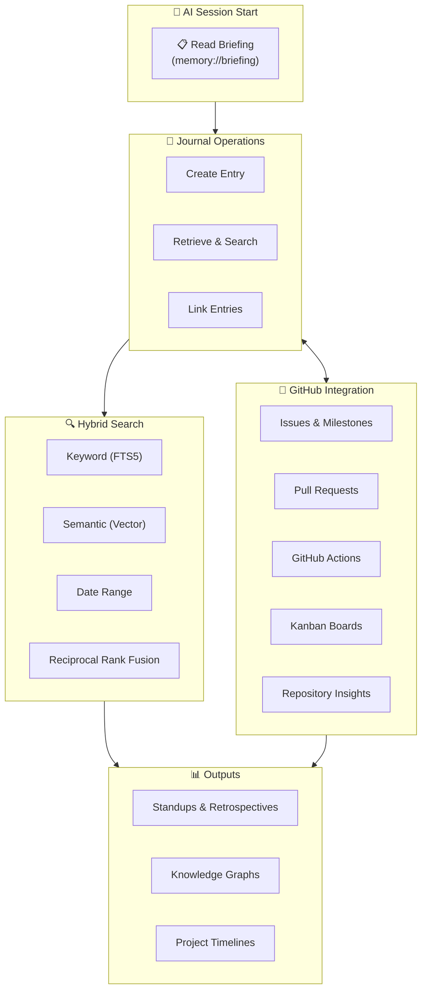
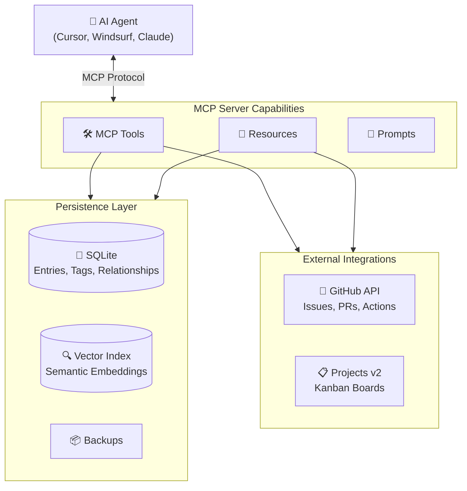

# Memory Journal MCP Server

<!-- mcp-name: io.github.neverinfamous/memory-journal-mcp -->

[](https://github.com/neverinfamous/memory-journal-mcp) [](https://www.npmjs.com/package/memory-journal-mcp) [](https://hub.docker.com/r/writenotenow/memory-journal-mcp)
[](https://opensource.org/licenses/MIT) 
[](https://registry.modelcontextprotocol.io/v0/servers?search=io.github.neverinfamous/memory-journal-mcp) [](SECURITY.md) [](https://github.com/neverinfamous/memory-journal-mcp)
  
 [](https://github.com/neverinfamous/memory-journal-mcp/actions/workflows/gatekeeper.yml)

**[📚 Full Documentation (Wiki)](https://github.com/neverinfamous/memory-journal-mcp/wiki)** • **[Changelog](CHANGELOG.md)** • **[Security](SECURITY.md)** • **[Release Article](https://adamic.tech/articles/memory-journal-mcp-server)**

> [!TIP]
> **Value Proposition**
> Bridge disconnected AI sessions seamlessly. Enable persistent project memory instantly. Automate handoffs with robust GitHub integration. Eliminate AI amnesia today.

**🚀 Quick Deploy:**

- **[npm Package](https://www.npmjs.com/package/memory-journal-mcp)** - `npm install -g memory-journal-mcp` (or `pnpm add -g memory-journal-mcp`)
- **[Docker Hub](https://hub.docker.com/r/writenotenow/memory-journal-mcp)** - Alpine-based with full semantic search

## 🧠 Eliminate AI Amnesia

Large projects face a critical challenge. You lose context between sessions.

- **Stop Thread Amnesia** - AI conversations start fresh. They ignore previous work.
- **Retain Deep Context** - You scatter decisions and code across threads. We save them.
- **End Repeated Work** - AI repeats failed solutions. We remember your attempts.
- **Prevent Context Overload** - You copy history manually. We automate context delivery.

Memory Journal builds your project's long-term memory. It bridges fragmented AI sessions seamlessly.

---

**Experience true context-aware development:**

- _"Why did we choose SQLite over Postgres for this service last month?"_ (Semantic search)
- _"Run the `/issue-triage` workflow on the top priority ticket in the Kanban board."_ (GitHub operations)
- _"Who has been touching the auth module recently, and what's our team collaboration density?"_ (Team analytics)
- _"Commit the changes and automatically generate a structured journal entry using the \`--journal\` wrapper flag."_ (Automated lifecycles)
- _"Draw a visual graph showing how my last 10 architectural decisions relate to each other."_ (Knowledge graph)

**Comprehensive access to internal state via resources (`memory://briefing`, `memory://workflows`, `memory://rules`, `memory://health`, `memory://help`, `memory://staleness`, GitHub status/insights, team stats, metrics/latency, and more) plus dynamic repo variants for cross-repo targeting (like `memory://briefing/{repo}` or `memory://kanban/{repo}/{project_number}`).** **[Resources documentation →](https://github.com/neverinfamous/memory-journal-mcp/wiki/Resources)**

---

## 🎯 What Sets Us Apart

**MCP Tools** · **Workflow Prompts** · **Resources** · **Tool Groups** · **Code Mode** · **GitHub Commander** (Issue Triage, PR Review, Milestone Sprints, Security/Quality/Perf Audits) · **GitHub Integration** (Issues, PRs, Actions, Kanban, Milestones, Insights) · **Team Collaboration** (Shared DB, Vector Search, Cross-Project Insights)

| Feature                       | Description                                                                                                                                                                                          |
| ----------------------------- | ---------------------------------------------------------------------------------------------------------------------------------------------------------------------------------------------------- |
| **Session Intelligence**      | Auto-query project history, create checkpoints, and hand off context between sessions automatically.                                                                                                 |
| **GitHub Integration**        | Manage Issues, PRs, Actions, Kanban boards, and milestones. Access Copilot reviews and repository insights.                                                                                          |
| **Dynamic Project Routing**   | Switch contexts seamlessly and access CI/Issue tracking across multiple repositories from a single server instance.                                                                                  |
| **Knowledge Graphs**          | Link specifications, implementations, tests, and PRs visually using Mermaid diagrams.                                                                                                                |
| **Hybrid Search**             | Find entries instantly using a blend of keyword, semantic, and date-range searches.                                                                                                                  |
| **Code Mode**                 | Execute multi-step operations efficiently in a sandboxed environment to reduce token usage.                                                                                                          |
| **Adaptive Session Briefing** | Deliver real-time workspace context dynamically, including live CI health, local Git status, and unreleased changes.                                                                                 |
| **Reports & Analytics**       | Generate standups, retrospectives, PR summaries, digests, and period analyses.                                                                                                                       |
| **Heuristic Scoring**         | Optimize context delivery by scoring entries based on veracity and impact.                                                                                                                           |
| **Team Collaboration**        | Share databases across teams with cross-project insights, author attribution, and role-based access control.                                                                                         |
| **Data Interoperability**     | Export schemas safely, sync Markdown directories, and maintain a unified IO namespace.                                                                                                               |
| **Backup & Restore**          | Secure data with automated scheduling, retention policies, and one-command restores.                                                                                                                 |
| **Auto-Pruning**              | Soft-delete low-value entries automatically to maintain search relevance over long-running projects.                                                                                                 |
| **Security & Transport**      | Ensure secure connections with OAuth 2.1, Streamable HTTP, rate limiting, and SQL injection prevention.                                                                                              |
| **Structured Error Handling** | Provide agents with classification, remediation hints, and recoverability signals on every tool call.                                                                                                |
| **Agent Collaboration**       | Share context between IDE agents and Copilot. Search review findings and let agents suggest reusable rules.                                                                                          |
| **Native Agent Skills**       | Establish permanent AI behavior and architecture rules using bundled foundational coding paradigms.                                                                                                  |
| **GitHub Commander**          | Audit code, triage issues, review PRs, and run sprint milestones via automated pipeline skills.                                                                                                      |

---

### Isolate Environments with Multi-Tenancy

Memory Journal supports multi-tenancy out of the box via the `workspace_id` construct, acting as a strict isolation barrier for multiple journals sharing the same SQLite database file.

- **Default Isolation:** If omitted, all entries are created in and retrieved from the `default` workspace.
- **Data Partitioning:** Core CRUD, Search, and Analytics tools accept a `workspace_id` parameter (e.g., `workspace_id: "alpha"`) to scope operations strictly to that workspace.
- **Immutability:** A `workspace_id` is permanently assigned upon entry creation and **cannot be changed** afterward.
- **Server Config:** Set `--default-workspace-id` (or the `DEFAULT_WORKSPACE_ID` environment variable) to configure the default fallback workspace for the server instance, allowing you to run multiple isolated journal interfaces on a single physical database.

---



---

_Suggested Rule (Add to AGENTS.md, GEMINI.md, system prompts, etc.)_

<details>
<summary><strong>View Session Initialization Routine</strong></summary>

🛑 Session Initialization Routine

When the user initializes the session context by executing the `load-briefing` prompt:

1. You will receive the output of the `memory://briefing/{repo_name}` resource.
2. Prepend your response EXACTLY as:
   > **📋 Briefing loaded** — `{repo_name}`
   > _{paste ENTIRE briefing here}_
3. Address the user's request below the briefing.
4. NEVER autonomously execute tasks listed in the briefing.
5. Do NOT proactively ask the user to load the briefing. Wait for them to use the prompt.
</details>

---

### Control Access with Tool Filtering

> [!IMPORTANT]
> All shortcuts and tool groups include **Code Mode** (`mj_execute_code`) by default for token-efficient operations. To exclude it, add `-codemode` to your filter: `--tool-filter starter,-codemode`

Control which tools are exposed via `MEMORY_JOURNAL_MCP_TOOL_FILTER` (or CLI: `--tool-filter`):

| Filter               | Use Case                 |
| -------------------- | ------------------------ |
| `full`               | All tools (default)      |
| `starter`            | Core + search + codemode |
| `essential`          | Minimal footprint        |
| `readonly`           | Disable all mutations    |
| `-github`            | Exclude a group          |
| `-github,-analytics` | Exclude multiple groups  |

**Filter Syntax:** `shortcut` or `group` or `tool_name` (whitelist mode) · `-group` (disable group) · `-tool` (disable tool) · `+tool` (re-enable after group disable)

**Custom Selection:** List individual tool names to create your own whitelist: `--tool-filter "create_entry,search_entries,semantic_search"`

**Groups:** `core`, `search`, `analytics`, `relationships`, `io`, `admin`, `github`, `git`, `backup`, `team`, `codemode`

**[Complete tool filtering guide →](https://github.com/neverinfamous/memory-journal-mcp/wiki/Tool-Filtering)**

---

## 📋 Unlock Core Capabilities

### 🛠️ **MCP Tools**

| Group           | Description                                                                                                                                                                                       |
| --------------- | ------------------------------------------------------------------------------------------------------------------------------------------------------------------------------------------------- |
| `codemode`      | Code Mode (sandboxed code execution) 🌟 **Recommended**                                                                                                                                           |
| `core`          | Entry CRUD, tags, test, staleness                                                                                                                                                                 |
| `search`        | Text search, date range, semantic, vector stats, cross-team                                                                                                                                       |
| `analytics`     | Statistics, cross-project insights                                                                                                                                                                |
| `relationships` | Link entries, visualize graphs                                                                                                                                                                    |
| `io`            | JSON/Markdown export and File-level Markdown Data Integration Interoperability (Import/Export)                                                                                                    |
| `admin`         | Update configuration, update, delete, restore, rebuild/add to vector index, merge tags, search audit log, bulk operations (batch create/update/delete)                                            |
| `github`        | Issues, PRs, context, Kanban, **Milestones**, **Insights**, **issue lifecycle**, **Copilot Reviews**                                                                                              |
| `git`           | Commit history, search, release info, patterns, staleness checks                                                                                                                                  |
| `backup`        | Backup, list, restore, cleanup                                                                                                                                                                    |
| `team`          | CRUD, search, stats, relationships, IO (Markdown import/export), backup, vector search, cross-project insights, matrix, RBAC member management (requires `TEAM_DB_PATH`) |

**[Complete tools reference →](https://github.com/neverinfamous/memory-journal-mcp/wiki/Tools)**

### 🎯 **Workflow Prompts**

Session briefing, time period analysis, goal tracking, PR & issue command, session summaries, adversarial plan reviews, exhaustive code & security audits, secure commit workflows, anti-hallucination healing. **[Complete prompts guide →](https://github.com/neverinfamous/memory-journal-mcp/wiki/Prompts)**

### 📡 **Resources**
See the **[Complete resources guide →](https://github.com/neverinfamous/memory-journal-mcp/wiki/Resources)** for the full list of dynamic context resources, including `memory://briefing`, `memory://instructions`, GitHub integration endpoints, telemetry metrics, and templated views.

_Note: The `memory://briefing`, `memory://graph/actions`, `memory://actions/recent`, `memory://github/status`, `memory://github/insights`, `memory://github/milestones`, `memory://milestones/{number}`, `memory://kanban/{project_number}`, and `memory://kanban/{project_number}/diagram` resources also accept an optional `/{repo}` path suffix for cross-repo targeting._

---

## ⚡ Code Mode: Maximum Efficiency (90% Token Savings)

Code Mode (`mj_execute_code`) is a revolutionary approach that **dramatically reduces token usage by up to 90%** and is included by default in all presets. Instead of spending thousands of tokens on sequential tool calls, AI agents use a single sandboxed execution to reason faster.

Code executes in a **worker_threads sandbox** designed as a secure multi-tenant process isolation environment. All `mj.*` API calls execute against the journal within the sandbox, providing:

- **V8 code generation restrictions** — `eval()` and `Function()` construction from strings disabled at the V8 engine level via `codeGeneration: { strings: false, wasm: false }`
- **Frozen prototypes** — all built-in prototypes (Object, Function, Array, Error, etc.) frozen inside the vm context to prevent dynamic constructor chain escapes
- **Static code validation** — Multiple static regex rules blocking `require()`, `process`, `eval()`, `Reflect.*`, `Symbol.*`, `new Proxy()`, and filesystem/network access
- **Proxy constructor nullified** — `Proxy: undefined` in the sandbox prevents meta-object protocol abuse
- **RPC allowlist** — host-side validation prevents workers from invoking unauthorized API methods
- **Rate limiting** — 60 executions per minute per client
- **Hard timeouts** — configurable execution limit (default 30s)
- **Egress boundary enforcement** — result serialization capped to prevent OOM via oversized payloads
- **Full API access** — all tool groups are available via `mj.*` (e.g., `mj.core.createEntry()`, `mj.search.searchEntries()`, `mj.github.getGithubIssues()`)
- **Strict Readonly Contract** — Calling any mutation method under `--tool-filter readonly` safely halts the sandbox to prevent execution, returning a structured `{ success: false, error: "..." }` response to the agent instead of a raw MCP protocol exception.

### ⚡ Code Mode Only (Maximum Token Savings)

Run with **only Code Mode enabled** — a single tool that provides access to its full capability through the `mj.*` API:

```json
{
  "mcpServers": {
    "memory-journal-mcp": {
      "command": "memory-journal-mcp",
      "args": ["--tool-filter", "codemode"]
    }
  }
}
```

This exposes just `mj_execute_code`. The agent writes JavaScript against the typed `mj.*` SDK — composing operations across all tool groups and returning exactly the data it needs — in one execution. This mirrors the [Code Mode pattern](https://blog.cloudflare.com/code-mode-mcp/) pioneered by Cloudflare for their entire API: fixed token cost regardless of how many capabilities exist.

#### Disabling Code Mode

If you prefer individual tool calls, exclude codemode:

```json
{
  "args": ["--tool-filter", "starter,-codemode"]
}
```

---

_Note: Configuration is resolved using strict precedence: `CLI flags > Environment Variables > Config File > Defaults`._

> 🛠️ **Debugging Configuration:** Run `memory-journal-mcp --dump-config` (or pass `--dump-config` as an arg) to print the fully resolved configuration payload with automatically redacted secrets. This is the primary method for diagnosing overriding issues.

### Configure Basics Quickly

> 💡 **Tip:** Don't want to manually escape JSON strings for `PROJECT_REGISTRY`? Run `npx memory-journal-mcp project create` in your terminal to automatically bootstrap and update your MCP configuration!

```json
{
  "mcpServers": {
    "memory-journal-mcp": {
      "command": "memory-journal-mcp",
      "env": {
        "GITHUB_TOKEN": "ghp_your_token_here",
        "PROJECT_REGISTRY": "{\"my-repo\":{\"path\":\"/path/to/your/git/repo\",\"project_number\":1}}",
        "ALLOWED_IO_ROOTS": "/path/to/your/git/repo"
      }
    }
  }
}
```

### Power Up with Advanced Configuration

Showcasing the full power of the server, including Multi-Project Routing, Team Collaboration, Copilot awareness, and Context Injections.

> 💡 **Tip:** Use `npx memory-journal-mcp project create` to easily configure multiple repositories into your `PROJECT_REGISTRY` without manual JSON escaping!

```json
{
  "mcpServers": {
    "memory-journal-mcp": {
      "command": "memory-journal-mcp",
      "env": {
        "DB_PATH": "/path/to/your/memory_journal.db",
        "TEAM_DB_PATH": "/path/to/shared/team.db",
        "GITHUB_TOKEN": "ghp_your_token_here",
        "PROJECT_REGISTRY": "{\"my-repo\":{\"path\":\"/path/to/repo\",\"project_number\":1},\"other-repo\":{\"path\":\"/path/to/other\",\"project_number\":5}}",
        "ALLOWED_IO_ROOTS": "/path/to/repo,/path/to/other,/path/to/your/skills",
        "AUTO_REBUILD_INDEX": "true",
        "MEMORY_JOURNAL_MCP_TOOL_FILTER": "codemode",
        "CODEMODE_INTERNAL_FULL_ACCESS": "true",
        "BRIEFING_ENTRY_COUNT": "3",
        "BRIEFING_SUMMARY_COUNT": "1",
        "BRIEFING_INCLUDE_TEAM": "true",
        "BRIEFING_ISSUE_COUNT": "3",
        "BRIEFING_PR_COUNT": "3",
        "BRIEFING_PR_STATUS": "true",
        "BRIEFING_WORKFLOW_COUNT": "3",
        "BRIEFING_WORKFLOW_STATUS": "true",
        "BRIEFING_COPILOT_REVIEWS": "true",
        "RULES_FILE_PATH": "/path/to/your/RULES.md",
        "SKILLS_DIR_PATH": "/path/to/your/skills",
        "MEMORY_JOURNAL_WORKFLOW_SUMMARY": "/deploy: prod deployment | /audit: security scan",
        "AUDIT_LOG_PATH": "/path/to/your/mcp-audit.jsonl",
        "TEAM_AUTHOR": "your_username"
      }
    }
  }
}
```

> 💡 **Tip:** Optimize your context window! **Journal entries** (`BRIEFING_ENTRY_COUNT`) capture frequent, granular actions (e.g. bug fixes, implementation steps). **Session summaries** (`BRIEFING_SUMMARY_COUNT`) surface high-level retrospectives meant to pass strategic context continuously across distinct AI sessions. Use both appropriately to keep the agent briefing highly focused!

### 📋 Customizing the Session Briefing

The `memory://briefing` resource is **dynamically assembled** at each session start to provide rich, token-efficient ambient context. By default, it automatically surfaces:

- **System State:** Server version, capability statuses, resource/tool counts, test health, and `memory://metrics/summary` breadcrumbs.
- **Repository Context:** Git working tree status, unreleased changes, exact code-map paths, and prioritized gatekeeper CI workflows.
- **Ambient Context:** Active workspace paths, local time, analytics.

You control exactly what additional content your agent sees across three dimensions:

| Dimension             | Variables                                                                                                                                                                        | What It Controls                                                                    |
| --------------------- | -------------------------------------------------------------------------------------------------------------------------------------------------------------------------------- | ----------------------------------------------------------------------------------- |
| **Focus**             | `TOOL_FILTER`                                                                                                                                                                    | Control tool exposure: `full` (default), `starter`, `essential`                     |
| **Journal Content**   | `BRIEFING_ENTRY_COUNT`, `BRIEFING_SUMMARY_COUNT`, `BRIEFING_INCLUDE_TEAM`                                                                                                        | How many recent entries, session summaries, and whether team entries appear         |
| **GitHub Enrichment** | `BRIEFING_ISSUE_COUNT`, `BRIEFING_PR_COUNT`, `BRIEFING_PR_STATUS`, `BRIEFING_MILESTONE_COUNT`, `BRIEFING_WORKFLOW_COUNT`, `BRIEFING_WORKFLOW_STATUS`, `BRIEFING_COPILOT_REVIEWS` | Issues, PRs, milestones, CI runs, and Copilot review state surfaced in the briefing |

**Context Injections:** Set `RULES_FILE_PATH` and `SKILLS_DIR_PATH` to surface user rules and agent skills as companion resources (`memory://rules`, `memory://skills`) alongside the briefing.

**Repo Targeting:** In multi-repo setups, agents read `memory://briefing/{repo}` to get a briefing scoped to a specific repository registered in `PROJECT_REGISTRY`.

<details>
<summary><strong>Briefing Presets (click to expand)</strong></summary>

**Minimal (fast sessions)** — Reduce briefing to bare essentials for quick interactions:

```json
"BRIEFING_ENTRY_COUNT": "1",
"BRIEFING_SUMMARY_COUNT": "0",
"TOOL_FILTER": "essential"
```

**Full Context (onboarding agents)** — Maximize context for agents unfamiliar with the project:

```json
"BRIEFING_ENTRY_COUNT": "5",
"BRIEFING_SUMMARY_COUNT": "3",
"BRIEFING_INCLUDE_TEAM": "true",
"BRIEFING_ISSUE_COUNT": "5",
"BRIEFING_PR_COUNT": "3",
"BRIEFING_PR_STATUS": "true",
"BRIEFING_COPILOT_REVIEWS": "true",
"TOOL_FILTER": "full"
```

**DevOps-Heavy** — Emphasize CI/CD and GitHub state for infrastructure workflows:

```json
"BRIEFING_WORKFLOW_COUNT": "5",
"BRIEFING_WORKFLOW_STATUS": "true",
"BRIEFING_ISSUE_COUNT": "3",
"BRIEFING_PR_COUNT": "3",
"BRIEFING_PR_STATUS": "true",
"BRIEFING_COPILOT_REVIEWS": "true"
```

</details>

**[Full briefing customization guide →](https://github.com/neverinfamous/memory-journal-mcp/wiki/Configuration#session-briefing-customization)**

**Variants** (modify the config above):

| Variant                 | Change                                                                                                                       |
| ----------------------- | ---------------------------------------------------------------------------------------------------------------------------- |
| **Minimal (no GitHub)** | Remove the `env` block entirely                                                                                              |
| **npx (no install)**    | Replace `"command"` with `"npx"` and add `"args": ["-y", "memory-journal-mcp"]`                                              |
| **From source**         | Replace `"command"` with `"node"` and add `"args": ["dist/cli.js"]`                                                          |
| **Code Mode only**      | Add `"args": ["--tool-filter", "codemode"]` (single tool, all capabilities)                                                  |
| **Docker**              | Replace `"command"` with `"docker"` and use `run -i --rm -v ./data:/app/data writenotenow/memory-journal-mcp:latest` as args |
| **Team collaboration**  | Add `"TEAM_DB_PATH": "./team.db"` to `env`                                                                                   |

Restart your MCP client and start journaling!

### Connect Remotely with HTTP/SSE Transport

> 🔒 **Security Posture: Stdio vs HTTP**
>
> - **Stdio (Default):** Runs implicitly within the secure boundaries of your local IDE or command-line environment. No explicit authentication is required because the execution context is already trusted.
> - **HTTP/SSE:** Exposes the server over a network socket. By default, HTTP binds ONLY to `localhost` and blocks wildcard CORS to prevent unauthorized access and CSRF attacks. **Public network binding (`--server-host 0.0.0.0`) requires explicit authentication** (`--auth-token` or `--oauth-enabled`). The server will throw a fatal error if you attempt to expose it publicly without securing it.

For remote access or web-based clients, run the server in HTTP mode:

```bash
memory-journal-mcp --transport http --port 3000
```

To bind to all interfaces (required for containers) and enable the automated proactive analytics scheduler (e.g. daily digest), you MUST provide an authentication token:

```bash
export MCP_AUTH_TOKEN="your_secure_random_token"
memory-journal-mcp --transport http --port 3000 --server-host 0.0.0.0 --digest-interval 1440
```

**Endpoints:**

| Endpoint                                    | Description                                      | Mode     |
| ------------------------------------------- | ------------------------------------------------ | -------- |
| `GET /`                                     | Server info and available endpoints              | Both     |
| `POST /mcp`                                 | JSON-RPC requests (initialize, tools/call, etc.) | Both     |
| `GET /mcp`                                  | SSE stream for server-to-client notifications    | Stateful |
| `DELETE /mcp`                               | Session termination                              | Stateful |
| `GET /sse`                                  | Legacy SSE connection (MCP 2024-11-05)           | Stateful |
| `POST /messages`                            | Legacy SSE message endpoint                      | Stateful |
| `GET /health`                               | Health check (`{ status, timestamp }`)           | Both     |
| `GET /metrics`                              | Prometheus metrics export (requires flag)        | Both     |
| `GET /.well-known/oauth-protected-resource` | RFC 9728 Protected Resource Metadata             | Both     |

**Session Management:** The server uses stateful sessions by default. Include the `mcp-session-id` header (returned from initialization) in subsequent requests.

- **OAuth 2.1** — RFC 9728/8414, JWT/JWKS, granular scopes (opt-in via `--oauth-enabled`)
- **Comprehensive Security Headers** — CSP, HSTS (opt-in), X-Frame-Options, and more
- **Rate Limiting** — 100 req/min per IP · **CORS** — configurable multi-origin (exact-match) · **1MB body limit**
- **Server Timeouts** — Request (120s), keep-alive (65s), headers (66s) · **404 handler** · **Cross-protocol guard**
- **Build Provenance** · **SBOM** · **Supply Chain Attestations** · **Non-root execution**

**Example with curl:**

Initialize session (returns `mcp-session-id` header):

```bash
curl -X POST http://localhost:3000/mcp \
  -H "Content-Type: application/json" \
  -H "Accept: application/json, text/event-stream" \
  -d '{"jsonrpc":"2.0","id":1,"method":"initialize","params":{"protocolVersion":"2025-03-26","capabilities":{},"clientInfo":{"name":"test","version":"1.0"}}}'
```

List tools (with session):

```bash
curl -X POST http://localhost:3000/mcp \
  -H "Content-Type: application/json" \
  -H "Accept: application/json, text/event-stream" \
  -H "mcp-session-id: YOUR_SESSION_ID" \
  -d '{"jsonrpc":"2.0","id":2,"method":"tools/list","params":{}}'
```

#### Stateless Mode (Serverless)

For serverless deployments (Lambda, Workers, Vercel), use stateless mode:

```bash
memory-journal-mcp --transport http --port 3000 --stateless
```

| Mode                      | Progress Notifications | Legacy SSE | Serverless |
| ------------------------- | ---------------------- | ---------- | ---------- |
| Stateful (default)        | ✅ Yes                 | ✅ Yes     | ⚠️ Complex |
| Stateless (`--stateless`) | ❌ No                  | ❌ No      | ✅ Native  |

#### Automated Scheduling (HTTP Only)

When running in HTTP/SSE mode, enable periodic maintenance jobs with CLI flags. These jobs run in-process on `setInterval` — no external cron needed.

> **Note:** These flags are ignored for stdio transport because stdio sessions are short-lived (tied to your IDE session). For stdio, use OS-level scheduling (Task Scheduler, cron) or run the backup/cleanup tools manually.

```bash
memory-journal-mcp --transport http --port 3000 \
  --backup-interval 60 --keep-backups 10 \
  --vacuum-interval 1440 \
  --rebuild-index-interval 720
```

| Flag                             | Default | Description                                                          |
| -------------------------------- | ------- | -------------------------------------------------------------------- |
| `--backup-interval <min>`        | 0 (off) | Create timestamped database backups and prune old ones automatically |
| `--keep-backups <count>`         | 5       | Max backups retained during automated cleanup                        |
| `--vacuum-interval <min>`        | 0 (off) | Run `PRAGMA optimize` and flush database to disk                     |
| `--rebuild-index-interval <min>` | 0 (off) | Full vector index rebuild to maintain semantic search quality        |
| `--report-interval <min>`        | 0 (off) | Scheduled report generation interval in minutes                      |
| `--digest-interval <min>`        | 0 (off) | Scheduled periodic digest analysis report                            |

Each job is error-isolated — a failure in one job won't affect the others. Scheduler status (last run, result, next run) is visible via `memory://health`.

### Integrate Seamlessly with GitHub

The GitHub tools (`get_github_issues`, `get_github_prs`, etc.) auto-detect the repository from your git context when `PROJECT_REGISTRY` is configured or the MCP server is run inside a git repository.


**Multi-Project Workflows**: For agents to seamlessly support multiple projects, configure your **`PROJECT_REGISTRY`** (tip: use `npx memory-journal-mcp project create`).

#### Dynamic Context Resolution & Auto-Detection

When executing GitHub tools (issues, PRs, context, etc.), the server resolves repository context in this order:

1. **Dynamic Project Routing**: If the agent passes a `repo` string that matches a key in your `PROJECT_REGISTRY`, the server dynamically mounts the physical directory mapped to that project. It executes git commands locally and automatically infers the `owner`.
2. **Explicit Override**: If the agent provides both `owner` and `repo` explicitly, those values override auto-detection for API calls.
3. **Missing Context**: Without `PROJECT_REGISTRY` or explicit parameters, the server blocks execution and returns `{requiresUserInput: true}` to prompt the agent. If an agent encounters this blocked state, it can seamlessly recover by invoking the `mj.admin.registerProject()` method via Code Mode to auto-configure the project registry on the fly.

#### Automatic Project Routing (Kanban / Issues)

When opening an issue or viewing/moving a Kanban card, the server needs a GitHub Project number. It determines this via:

1. Exploring the raw `project_number` argument passed by the agent.
2. Checking if the `repo` string precisely matches an entry in your **`PROJECT_REGISTRY`**, seamlessly mapping it to its pre-configured `project_number`.
3. Falling back to the globally defined `DEFAULT_PROJECT_NUMBER` if set.

### 🔐 OAuth 2.1 Authentication

For production deployments, enable OAuth 2.1 authentication on the HTTP transport:

| Component                   | Status | Description                                      |
| --------------------------- | ------ | ------------------------------------------------ |
| Protected Resource Metadata | ✅     | RFC 9728 `/.well-known/oauth-protected-resource` |
| Auth Server Discovery       | ✅     | RFC 8414 metadata discovery with caching         |
| Token Validation            | ✅     | JWT validation with JWKS support                 |
| Scope Enforcement           | ✅     | Granular `read`, `write`, `admin` scopes         |
| HTTP Transport              | ✅     | Streamable HTTP with OAuth middleware            |

**Supported Scopes:**

| Scope   | Tool Groups                                       |
| ------- | ------------------------------------------------- |
| `read`  | core, search, analytics, relationships, io        |
| `write` | github, team (+ all read groups)                  |
| `admin` | admin, backup, codemode (+ all write/read groups) |

**Quick Start:**

```bash
memory-journal-mcp --transport http --port 3000 \
  --oauth-enabled \
  --oauth-issuer https://auth.example.com/realms/mcp \
  --oauth-audience memory-journal-mcp \
  --oauth-jwks-uri https://auth.example.com/realms/mcp/protocol/openid-connect/certs
```

Or via environment variables:

```bash
export OAUTH_ENABLED=true
export OAUTH_ISSUER=https://auth.example.com/realms/mcp
export OAUTH_AUDIENCE=memory-journal-mcp
export OAUTH_CLOCK_TOLERANCE=5
memory-journal-mcp --transport http --port 3000
```

> **Note:** OAuth is opt-in. When not enabled, the server falls back to simple token authentication via `MCP_AUTH_TOKEN` environment variable, or runs without authentication.

### 🔄 Session Management

1. **Session start** → agent reads `memory://briefing` (or `memory://briefing/{repo}`) and shows project context
2. **Session summary** → use `/session-summary` to capture progress and next-session context
3. Next session's briefing includes the previous summary — context flows seamlessly

## 🔧 Configuration

### Environment Variables

| Variable                                       | Description                                                |
| ---------------------------------------------- | ---------------------------------------------------------- |
| **Core Database** | |
| `DB_PATH`                                      | Path to the personal journal SQLite database               |
| `TEAM_DB_PATH`                                 | Path to the shared team SQLite database                    |
| `GITHUB_TOKEN`                                 | Personal access token for GitHub integrations              |
| `PROJECT_REGISTRY`                             | JSON map of repo names to local paths and project numbers  |
| **Security & Tooling** | |
| `ALLOWED_IO_ROOTS`                             | Comma-separated paths for Code Mode filesystem boundaries  |
| `TOOL_FILTER`                                  | Control tool exposure (`full`, `starter`, `readonly`, `-github`) |
| `CODE_MODE_MAX_RESULT_SIZE`                    | Max execution payload buffer size in Code Mode (bytes)     |
| `CODEMODE_INTERNAL_FULL_ACCESS`                | Allow Code Mode to bypass tool filters internally          |
| `MCP_AGENT_HEALING`                            | Enable/disable autonomous tool & parameter healing (`true`/`false`, CLI: `--no-agent-healing`) |
| `MAX_TOOL_INPUT_ELEMENTS`                      | Max array/object elements in tool inputs (default: `25000`, `0` = disabled) |
| **Briefing & Context** | |
| `BRIEFING_ENTRY_COUNT`                         | Number of granular journal entries in briefing (default: 3)|
| `BRIEFING_SUMMARY_COUNT`                       | Number of session summaries in briefing (default: 1)       |
| `BRIEFING_INCLUDE_TEAM`                        | Include entries from the team database (default: false)    |
| `BRIEFING_ISSUE_COUNT` / `BRIEFING_PR_COUNT`   | GitHub Issues and PRs to list with titles                  |
| `BRIEFING_MILESTONE_COUNT`                     | GitHub Milestones to list with titles                      |
| `BRIEFING_WORKFLOW_COUNT`                      | CI workflow runs to list                                   |
| `RULES_FILE_PATH` / `SKILLS_DIR_PATH`          | Injected behavioral rules and skills boundaries            |
| **OAuth (HTTP Mode)** | |
| `OAUTH_ENABLED`                                | Enable OAuth 2.1 authentication (default: false)           |
| `OAUTH_ISSUER` / `OAUTH_AUDIENCE`              | OAuth token verification parameters                        |
| **Telemetry & Administration** | |
| `AUDIT_LOG_PATH` / `AUDIT_REDACT`              | File path for JSONL telemetry and argument redaction       |
| `MCP_METRICS_ENABLED` / `PERSIST_METRICS`      | In-memory and disk-persisted operational metrics           |
| `PRUNE_OLDER_THAN_DAYS` / `PRUNE_EXCLUDE_TAGS` | Auto-prune settings and exclusion tags                     |
| `REPORT_INTERVAL` / `REPORT_WEBHOOK_URL`       | Scheduled HTTP reports                                     |

### GitHub Integration (Optional)

```bash
export GITHUB_TOKEN="your_token"              # For Projects/Issues/PRs
```

**Scopes:** `repo`, `project`, `read:org` (org-level project discovery only)

### Manage GitHub Seamlessly

Memory Journal provides a **hybrid approach** to GitHub management:

| Capability Source  | Purpose                                                                                    |
| ------------------ | ------------------------------------------------------------------------------------------ |
| **MCP Server**     | Specialized features: Kanban visualization, Milestones, journal linking, project timelines |
| **Agent (gh CLI)** | Full GitHub mutations: create/close issues, create/merge PRs, manage releases              |

**MCP Server Tools (Read + Kanban + Milestones + Issue Lifecycle):**

See the **[Complete tools reference](https://github.com/neverinfamous/memory-journal-mcp/wiki/Tools)** for all supported GitHub integration capabilities, including query commands, Kanban management, milestone tracking, analytics, and issue lifecycle events.

> **Why this design?** The MCP server focuses on value-added features that integrate journal entries with GitHub (Kanban views, Milestones, timeline resources, context linking). Standard GitHub mutations (create/close issues, merge PRs, manage releases) are handled directly by agents via `gh` CLI.

**[Complete GitHub integration guide →](https://github.com/neverinfamous/memory-journal-mcp/wiki/Git-Integration)**

### Automate with GitHub Commander Workflows

The server natively bundles the `github-commander` agent skill (accessible via `memory://skills/github-commander`). This extends your AI assistant with autonomous DevOps workflows for repository stewardship: **Issue Triage**, **Milestone Sprints**, **PR Reviews**, **Copilot Audits**, **Security Audits**, **Code Quality Audits**, **Performance Audits**, **Roadmap Kickoffs**, and **Dependency Updates**. Configure validation layers using the `PROJECT_*` environment overrides to enforce CI-matching execution locally during agent tasks!

## 🏗️ Architecture

### Data Flow



### Stack

```
┌─────────────────────────────────────────────────────────────┐
│ MCP Server Layer (TypeScript)                               │
│  ┌─────────────────┐  ┌─────────────────┐  ┌─────────────┐  │
│  │ Tools            │  │ Resources       │  │ Prompts       │  │
│  └─────────────────┘  └─────────────────┘  └─────────────┘  │
├─────────────────────────────────────────────────────────────┤
│ Native SQLite Engine                                        │
│  ┌─────────────────┐  ┌─────────────────┐  ┌─────────────┐  │
│  │ better-sqlite3  │  │ sqlite-vec      │  │ transformers│  │
│  │ (High-Perf I/O) │  │ (Vector Index)  │  │ (Embeddings)│  │
│  └─────────────────┘  └─────────────────┘  └─────────────┘  │
├─────────────────────────────────────────────────────────────┤
│ SQLite Database with Hybrid Search                          │
│  ┌─────────────────────────────────────────────────────────┐│
│  │ entries + tags + relationships + embeddings + backups   ││
│  └─────────────────────────────────────────────────────────┘│
└─────────────────────────────────────────────────────────────┘
```

---

## 🔧 Technical Highlights

### Performance & Portability

- **TypeScript + Native SQLite** - High-performance `better-sqlite3` with synchronous I/O
- **sqlite-vec** - Vector similarity search via SQLite extension
- **@huggingface/transformers** - Local ML embedding models in JavaScript
- **Background Warmup** - Model weights (~23MB) are loaded into memory asynchronously on server startup to avoid first-request latency. If the server is invoked before warmup completes, the first semantic search or vector insertion will incur a network-bound cold start (~1.5s - 3s) while the weights are cached locally.

### Performance Benchmarks

Memory Journal is designed for extremely low overhead during AI task execution. We include a `vitest bench` suite to maintain these baseline guarantees:

- **Database Reads**: Operations execute in fractions of a millisecond. `calculateImportance` is ~13-14x faster than retrieving 50 recent entries.
- **Vector Search Engine**: Both search (~140-220 ops/sec) and indexing (~1600-1900+ ops/sec) are high-throughput via `sqlite-vec` with SQL-native KNN queries.
- **Core MCP Routines**: `getTools` uses cached O(1) dispatch (~4800-7000x faster than `get_recent_entries`). `create_entry` and `search_entries` execute through the full MCP layer with sub-millisecond overhead.

To run the benchmarking suite locally:

```bash
pnpm run bench
```

### Testing

Extensively tested across two frameworks:

| Suite                     | Command             | Covers                                                                          |
| ------------------------- | ------------------- | ------------------------------------------------------------------------------- |
| Vitest (unit/integration) | `pnpm test`         | Database, tools, resources, handlers, security, GitHub, vector search, codemode |
| Playwright (e2e)          | `pnpm run test:e2e` | HTTP/SSE transport, auth, sessions, CORS, security headers, scheduler           |

```bash
pnpm test          # Unit + integration tests
pnpm run test:e2e  # End-to-end HTTP/SSE transport tests
```

### Security

> **Note**: When updating schemas or validation logic, please refer to the `/zod` skill for best practices on Standard Schema and Safe Parsing.

- **Deterministic error handling** - Every tool returns structured `{success, error, code, category, suggestion, recoverable}` responses with actionable context — no raw exceptions, no silent failures, no misleading messages
- **Local-first** - All data stored locally, no external API calls (except optional GitHub)
- **Input validation** - Zod schemas, content size limits, SQL injection prevention
- **Path traversal protection** - Backup filenames validated
- **MCP 2025-03-26 annotations** - Behavioral hints (`readOnlyHint`, `destructiveHint`, etc.)
- **HTTP transport hardening** - comprehensive security headers, configurable multi-origin CORS, 1MB body limit, built-in rate limiting (100 req/min), server timeouts, HSTS (opt-in), 30-min session timeout, 404 handler, cross-protocol guard
- **Token scrubbing** - GitHub tokens and credentials automatically redacted from error logs

### Data & Privacy

- **Single SQLite file** - You own your data
- **Portable** - Move your `.db` file anywhere
- **Soft delete** - Entries can be recovered
- **Auto-backup on restore** - Never lose data accidentally

---

## 📚 Documentation & Resources

- **[GitHub Wiki](https://github.com/neverinfamous/memory-journal-mcp/wiki)** - Complete documentation
- **[Copilot Setup Guide](https://github.com/neverinfamous/memory-journal-mcp/wiki)** - Cross-agent memory bridge between IDE agents and GitHub Copilot
- **[Deployment Guide](https://github.com/neverinfamous/memory-journal-mcp/wiki/Deployment)** - CI/CD pipeline, environments, and version bump checklist
- **[Docker Hub](https://hub.docker.com/r/writenotenow/memory-journal-mcp)** - Container images
- **[npm Package](https://www.npmjs.com/package/memory-journal-mcp)** - Node.js distribution
- **[Issues](https://github.com/neverinfamous/memory-journal-mcp/issues)** - Bug reports & feature requests

---

## 📄 License

MIT License - See [LICENSE](LICENSE) file for details.

## 🤝 Contributing

Built by developers, for developers. PRs welcome! See [CONTRIBUTING.md](CONTRIBUTING.md) for guidelines.
