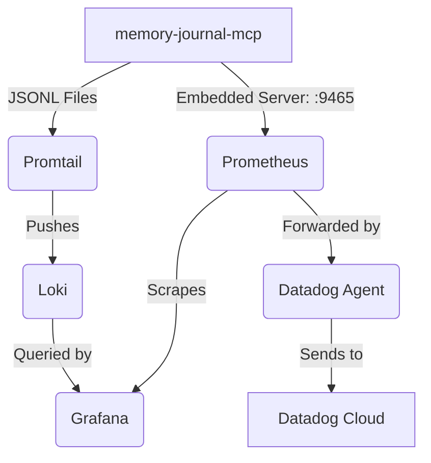

# Memory Journal MCP Observability Stack (Agent Reference)

This directory contains the satellite monitoring stack for `memory-journal-mcp`.

## Architecture

## Setup

Use `pnpm infra:up` to start the monitoring containers. 
The MCP server natively binds its embedded metrics server to `process.env.MJ_METRICS_PORT` (default `9465`) whenever `--metrics-export prometheus` is set, making it automatically scrapeable by Prometheus (`host.docker.internal:9465`) without requiring a separate terminal process.

## Ports
- Grafana: `3001` (admin/admin)
- Prometheus: `9090`
- Loki: `3101` (Note: `3101` to avoid collision with standard `3100`)
- Dozzle: `8080`

## Debugging

Run `pnpm infra:status` to execute the health-check script that verifies Prometheus target health.
