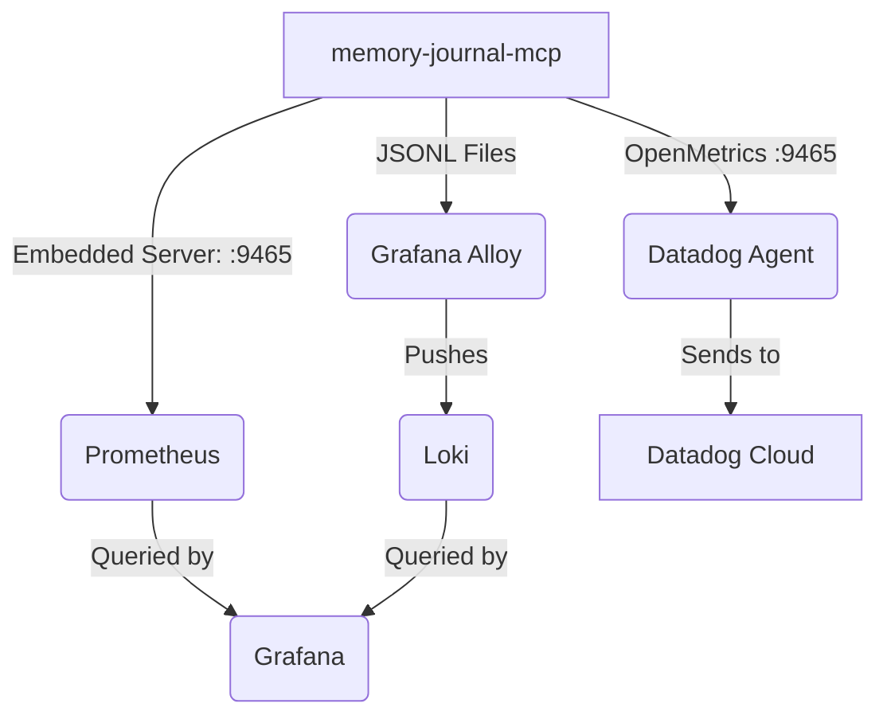

# Memory Journal MCP Observability Stack (Agent Reference)

This directory contains the satellite monitoring stack for `memory-journal-mcp`.

## Architecture

## Setup

Use `pnpm infra:up` (or `pnpm infra:reset` -> `node test-server/infrastructure/scripts/recreate-ecosystem.mjs` for a clean rebuild that omits `-v` on `docker compose down` so `mj-dozzle-data:/data` on `:8082` persists while `mj-infrastructure_prometheus_data` is reset) to start the monitoring containers (`mj-dozzle`, `mj-prometheus`, `mj-grafana`, `mj-loki`, `mj-alloy`, `mj-datadog-unified`, with `DD_HOSTNAME=${DD_HOSTNAME:-memory-journal-host}` and `DD_CONTAINER_INCLUDE=name:^mj-.*` / `DD_CONTAINER_EXCLUDE=name:.*`).
The MCP server natively binds its embedded metrics server strictly to loopback (`127.0.0.1:9465`, configurable via `MJ_METRICS_PORT`) whenever `--metrics-export prometheus` is set, exposing tool, token, latency, process, and `mcp_resource_reads_total` counters. On Windows + WSL2 `docker-ce` setups, `recreate-ecosystem.mjs` installs and restarts a lightweight user-systemd relay (`mj-metrics-relay.service` from `test-server/infrastructure/scripts/wsl-metrics-relay.mjs`) on WSL2's `docker0` `host-gateway` (`172.17.0.1:9465`) that forwards container scrapes (`host.docker.internal:9465`) to Windows `127.0.0.1:9465` without opening Windows Firewall or non-loopback host interfaces.

## Dashboards (`pup` CLI)

- Sync Datadog dashboards (`my6-q9k-682` `datadog-dashboard.json`, `79q-b3r-jhu` `datadog-ai-dashboard.json`) via `node test-server/infrastructure/scripts/backup-dashboards.mjs` and `upload-dashboards.mjs`.

## Ports
- Grafana: `3002` (admin/admin)
- Prometheus: `9091`
- Loki: `3102` (offset from `3100`/`3101` to coexist cleanly alongside sibling observability stacks)
- Dozzle: `8082`

## Debugging

Run `pnpm infra:status` (`node test-server/infrastructure/scripts/check-status.mjs`) to verify all `mj-*` container states, detect orphaned container rename prefixes, and probe Prometheus (`:9091`), Grafana (`:3002`), and Loki (`:3102`) health endpoints (falling back to `docker exec` when Windows `localhost` ports return `ECONNREFUSED`).
